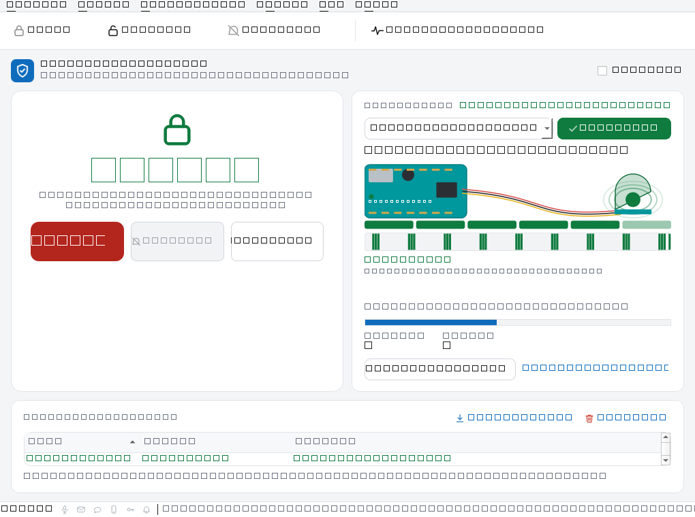
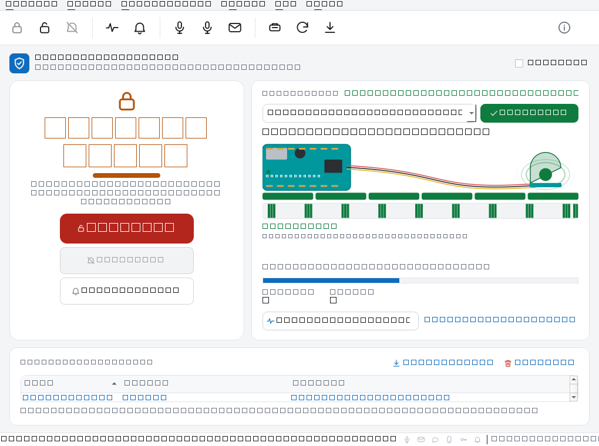

# Alarma de presencia — Arduino Mega 2560 + HC-SR501

[](https://github.com/jvelasca/alarma-casa-arduino/actions/workflows/ci.yml)
[](https://github.com/jvelasca/alarma-casa-arduino/releases)
[](LICENSE)

Sistema doméstico de detección de presencia no autorizada. El Arduino detecta y
reporta; el PC decide, avisa y registra.

Estado actual: **F1.10** — enlace serie real con protocolo v1, modo de ajuste del
sensor, capa de avisos (estado de alarma, voz configurable por evento, correo,
SMS y push gratuito al móvil con ntfy, zumbador en la placa), **mando remoto por
ntfy** desde el móvil con clave o TOTP, interfaz
**PyQt6** con pantalla principal y diálogos de configuración, **conexión
permanente** con reconexión y aviso de pérdida,
**registro persistente en SQLite** con exportación a CSV, **retardos de entrada
y salida** con pitidos acelerados, **rearme automático tras un disparo** —como
una central de mercado— y **copia de seguridad completa** con empaquetado en un
solo `.exe` para montarlo en otro PC. Pendiente: zonas, panel web y bandeja
(F2-F3) y las pruebas de larga duración de F4.

---

## Puesta en marcha

```powershell
# 1. Entorno Python (crea .venv, instala PyQt6 y el paquete)
.\scripts\setup.ps1

# 2. Firmware (compila y sube al Mega; detecta el puerto solo)
.\scripts\flash.ps1

# 3. Configuración (se crea sola al arrancar; edítala a tu gusto)
#    config\alarm.toml        -> comportamiento y valores de fábrica
#    config\alarm.local.toml  -> lo que cambies desde la propia app
#    .env                     -> credenciales SMTP, Twilio y ntfy (copia .env.example)

# 4. Aplicación
.\scripts\run.ps1
```

La mayoría de ajustes se cambian **desde la ventana** (**Herramientas →
Configuración de voces**, **Avisos → Correo, SMS y móvil**, **Herramientas →
Ajuste del sensor**), sin tocar el TOML. El SMS necesita una cuenta de Twilio con
crédito y un número remitente; la pestaña SMS dice qué campo falta y enlaza a la
Consola de Twilio. El aviso al móvil (ntfy) es **gratuito, sin SMS y sin tarjeta
SIM**: instalar la app, generar un tema y suscribirse a él; con el mismo canal,
la app puede además **dar órdenes** (armar, desarmar, consultar y silenciar) con
clave o código TOTP. Ver
[`doc/03-AVISOS.md`](doc/03-AVISOS.md) para la contraseña de aplicación de Gmail,
los pasos de Twilio, la puesta en marcha de ntfy, las voces instaladas y el
cableado del zumbador, y [`doc/04-INTERFAZ.md`](doc/04-INTERFAZ.md) para la
ventana y los diálogos.

O simplemente **F5 en Cursor**: `.vscode/launch.json` ya apunta al intérprete del
entorno virtual y arranca la aplicación. Configuraciones disponibles:

| Configuración | Qué hace |
|---|---|
| `Alarma (hardware)` | Abre la ventana y busca la placa conectada |
| `Alarma (simulada)` | Igual, con el dispositivo simulado (tiempo ×4) |
| `Alarma (simulada, depuración detallada)` | Lo anterior con registro `DEBUG` |
| `Consola: info` | Identifica el dispositivo sin abrir ventana |
| `Consola: ajuste del sensor` | Asistente de ajuste en terminal |
| `Pruebas (pytest)` | Ejecuta la batería de pruebas |

## Instalar en otro PC

El programa se empaqueta en **un solo fichero**, `AlarmaCasa.exe`, que no
necesita Python ni instalador. La carpeta `dist\` sale con el ejecutable y
`LEEME.txt`, las instrucciones para quien lo recibe:

```powershell
.\scripts\build.ps1          # deja dist\AlarmaCasa.exe y dist\LEEME.txt
```

`build.ps1` ejecuta antes pruebas, `ruff` y `mypy`, genera el icono y el recurso
de versión del ejecutable, y llama a PyInstaller (`packaging/alarma.spec`). La
primera vez tarda un par de minutos y el resultado pesa decenas de MB porque
lleva Qt dentro. El `LEEME.txt` se copia desde `packaging/LEEME.txt`.

### Llevar la configuración y las contraseñas

En el PC de origen: **Archivo → Guardar copia completa (con credenciales)…**
(`Ctrl+Mayús+B`). Sale un único `copia-alarma-AAAAMMDD-HHMM.alarmbackup` con la
configuración entera —incluido el puerto serie— y las credenciales de correo,
SMS y ntfy.

En el PC nuevo:

1. Copia `AlarmaCasa.exe` a una carpeta con permiso de escritura (por ejemplo
   `C:\Alarma` o el escritorio) y ábrelo. La primera vez crea `config\` y
   `data\` a su lado.
2. **Archivo → Restaurar copia completa…** (`Ctrl+Mayús+R`), elige el fichero y
   confirma. La configuración se aplica en caliente y las credenciales quedan en
   `.env`.
3. Conecta el Arduino. Si la copia traía otro `COMx`, el aviso final lo recuerda:
   reconecta o deja `port = "auto"` para que lo busque por VID/PID.

> **La copia lleva las contraseñas en claro.** Es JSON legible, sin cifrar, para
> que se pueda revisar y para no añadir dependencias de criptografía. Guárdala
> como guardarías una contraseña, no la dejes en una carpeta compartida y
> bórrala cuando ya no la necesites. Para compartir la configuración sin
> secretos está **Guardar configuración en JSON…**, que las deja en blanco.

Dos avisos prácticos:

- El `.exe` **no está firmado**. Windows puede mostrar *«Windows protegió tu
  PC»* o SmartScreen la primera vez: *Más información → Ejecutar de todas
  formas*. Firmarlo requiere un certificado de code signing, fuera del alcance
  de un proyecto personal.
- **El Arduino no hay que volver a programarlo.** El sketch vive en la placa;
  cambiar de PC solo cambia quién habla con ella. Si la placa es nueva, prográmala
  una vez desde un equipo con el repositorio (`.\scripts\flash.ps1`).

Si la carpeta del `.exe` no admite escritura (`C:\Program Files`), la aplicación
guarda configuración e historial en `%LOCALAPPDATA%\AlarmaCasa` y lo dice en el
registro y en *Acerca de*. El historial de eventos (`data\alarm.db`) no viaja en
la copia: se exporta a CSV con **Archivo → Exportar registro…**.

También se puede hacer por consola en cualquier equipo con el proyecto puesto
(`.venv` creado), útil para preparar varios PCs con un script:

```powershell
# Guardar (en el PC de origen)
.\.venv\Scripts\python.exe tools\alarmctl.py backup export --out copia.alarmbackup

# Aplicar (con `--yes` para no pedir confirmación)
.\.venv\Scripts\python.exe tools\alarmctl.py backup import --from copia.alarmbackup --yes
```

En el PC nuevo lo natural es la ventana: el `.exe` no lleva el CLI dentro.

## Avisos push gratis al móvil (ntfy)

Quinto canal, junto a voz, correo, SMS y zumbador. Notificaciones instantáneas en
el teléfono **sin SMS, sin tarifa adicional y sin tarjeta SIM especial**, en
Android y en iPhone. Usa [ntfy](https://ntfy.sh), que es gratuito y de código
abierto, y el programa habla con él con `urllib`: no hay dependencias nuevas.

1. Instala la app **ntfy** en el móvil.
2. **Avisos → Correo, SMS y móvil… → Móvil (ntfy)** y pulsa **Generar tema
   seguro**. Sale un nombre largo y aleatorio.
3. Suscríbete en la app a ese mismo tema, en `ntfy.sh`.
4. **Probar móvil** y marca **Enviar avisos al móvil (ntfy)**.

El disparo llega como prioridad `urgent` (suena aunque el móvil esté en
silencio), la pérdida de enlace como `high` y armar/desarmar como normal.

> En `ntfy.sh` un tema **no es privado**: quien conozca su nombre puede
> suscribirse. Por eso debe ser largo y aleatorio. Para control de acceso real,
> usa un servidor ntfy propio y guarda su token en `ALARM_NTFY_TOKEN` (`.env`).
> El diálogo avisa en ámbar si el tema es corto, si la conexión va por `http` o
> si el tema queda público.

Sin conexión no hay notificación, igual que con el correo y el SMS. Prueba desde
consola con `alarmctl.py ntfy-test`. Detalle completo en
[`doc/03-AVISOS.md`](doc/03-AVISOS.md) §6.

## Mando remoto desde el móvil (ntfy)

El mismo canal sirve para lo contrario: la app publica una orden y el PC la
ejecuta. Van por un **tema aparte**, `alarma-xxx-mando`, y la respuesta llega al
tema de avisos.

1. **Avisos → Mando remoto (ntfy)…**
2. Marca **Aceptar órdenes por ntfy**, pulsa **Generar clave** y cópiala.
3. Suscríbete en el móvil al **tema de mando** (el diálogo lo muestra y lo copia).
4. En la app, publica un mensaje en ese tema con la clave y la orden.
5. Guarda. El indicador de llave se pone azul.

```text
clave-7f3k9x armar
clave-7f3k9x consultar
clave-7f3k9x desarmar
```

Órdenes: `armar` (alias `activar`, `arm`), `desarmar` (`apagar`, `disarm`),
`consultar` (`estado`, `status`), `silenciar` (`callar`, `silencio`), `ayuda` y
`panico` (`panic`, desactivado por defecto). Se ignoran mayúsculas, acentos y la
puntuación; la clave puede ir antes o después. Cada orden aceptada contesta con
`[Mando] …` y deja fila en el historial.

`ayuda` es la única orden que no pide clave ni TOTP, se responde aunque el resto
esté desactivado y funciona con el mando bloqueado: solo lista las órdenes y un
ejemplo, sin revelar el estado de la casa.

En lugar de una clave se puede activar un **código TOTP** de 6 dígitos (Google
Authenticator, Authy…): con TOTP activo la clave deja de valer. Tras cinco
fallos, el mando se bloquea quince minutos y avisa una sola vez.

> Las órdenes se ejecutan solo con el PC encendido y la app abierta, y solo las
> **posteriores al arranque**: un `desarmar` de ayer no se aplica hoy. En
> `ntfy.sh` la clave viaja en el mensaje y quien lea el tema la ve; el TOTP
> caduca en 30 s. Para control de acceso real, servidor propio con token y ACL
> por usuario (`ntfy access`).

Prueba sin el móvil:

```powershell
# Escucha el tema de mando y dice si la clave o el TOTP valen (no ejecuta nada)
.\.venv\Scripts\python.exe tools\alarmctl.py remote-listen --seconds 60

# Publica una orden como lo haria el movil
.\.venv\Scripts\python.exe tools\alarmctl.py remote-send --action armar
```

Detalle completo en [`doc/03-AVISOS.md`](doc/03-AVISOS.md) §7.

## La ventana



Una sola pantalla: arriba el **estado grande** (ARMADA / DESARMADA / DISPARADA)
con un botón principal que arma o desarma según toque, al lado la tarjeta del
dispositivo (estado del enlace, puerto, conexión, panel del sensor con la placa
Arduino dibujada, calentamiento y contadores) y abajo el registro de eventos con
color por tipo, ordenable por columna, guardado en `data/alarm.db`.

Durante los retardos de armado y desarmado, y durante la espera del rearme
automático, el hero muestra un **reloj grande `MM:SS`** con una barra que se
vacía con el plazo:



El **calentamiento** del PIR se sigue con una barra de cuenta atrás en segundos:
arranca con el `warmup_ms` que anuncia la placa y se resincroniza con cada
latido, así que el número baja de verdad aunque se pierda algún mensaje. En
cuanto llega `Ready` desaparece, y **Omitir calentamiento** la esconde al
momento.

El **panel del sensor** enseña el hardware y su actividad en vivo, esté armada la
alarma o no: un LED que destella con cada latido, ondas cuando el PIR detecta,
seis barras que suben al moverse y bajan en unos 2,5 s, una franja con los
últimos 60 s y el tiempo desde la última detección. El HC-SR501 es digital, así
que se dibuja actividad reciente, no una distancia que no mide.

La cabecera de la tarjeta resume el enlace («● Conectado · latido hace 0,4 s»,
«● Reconectando · próximo intento en 3 s» o «● Sin enlace»), sin repetir el
mismo dato en dos sitios.

El botón de conexión dice en todo momento cómo está el enlace:

| Aspecto | Texto | Significado |
|---|---|---|
| Verde, deshabilitado | **Conectado** | La placa responde; el enlace se vigila con latidos |
| Ámbar, deshabilitado | **Reconectando…** | Se perdió el enlace y se reintenta solo |
| Gris, habilitado | **Conectar** | Sin enlace; pulsa para intentarlo ahora |

Al arrancar, si la placa está enchufada, se conecta sola. Si se desenchufa, el
registro anota **Sin sensor**, la voz avisa de que la alarma no está disponible y
salen correo, SMS y push al móvil según las casillas marcadas. Al volver a
enchufarla —incluso en otro puerto COM— se recupera sin reiniciar nada.

La barra de herramientas repite lo frecuente y los menús lo demás:

- **Archivo** → Conectar (`Ctrl+R`), Desconectar, **Exportar registro…** (`Ctrl+E`), **Guardar configuración en JSON…** (`Ctrl+Mayús+C`), Salir
- **Alarma** → Armar (`Ctrl+Mayús+A`), Desarmar (`Ctrl+D`), Silenciar (`Ctrl+Mayús+M`), Probar zumbador, **Zumbador…** (`Ctrl+Alt+B`), **Retardos y rearme…** (`Ctrl+Alt+R`)
- **Herramientas** → **Ajuste del sensor…** (`Ctrl+A`), Omitir calentamiento del PIR, **Guardar configuración en JSON…** (`Ctrl+Mayús+C`), Limpiar registro… (`Ctrl+L`)
- **Herramientas** → **Configuración de voces…** (`Ctrl+Alt+V`) con una tabla de los seis avisos (texto, etiqueta, repeticiones, retardo, intervalo y registro) y la voz del sistema; **Ajuste del sensor…** (`Ctrl+A`), Omitir calentamiento del PIR, Limpiar registro… (`Ctrl+L`)
- **Avisos** → **Configuración de voces…**, **Correo, SMS y móvil…**, **Mando remoto (ntfy)…**, casillas de voz/correo/SMS/móvil, Probar voz, Recargar configuración
- **Ver** → Mostrar latidos, Pitidos al ajustar
- **Ayuda** → Acerca de (`F1`), Contacto… con el correo **josealberto.vel@gmail.com**

Todos los controles tienen ayuda contextual al pasar el ratón. Al armar, la
alarma entra en **retardo de salida** (45 s por defecto): el hero muestra
`ARMANDO`, un **reloj grande** con los segundos que quedan y una barra que se
vacía con el plazo, mientras la placa pita cada vez más rápido para que salgas
de casa. Al terminar, se anuncia por voz y se arma de verdad. Cuando el PIR
detecta movimiento con la alarma armada empieza el **retardo de entrada** (30 s):
el hero muestra `ENTRADA` con su propio reloj y los pitidos, más agudos y
rápidos, dan tiempo a desarmar. Si el plazo vence, se dispara la alarma: voz
(con su retardo y repeticiones), correo, SMS, push al móvil y **sirena de dos
minutos** en el zumbador (duración programable de 1 a 600 s en `Alarma →
Zumbador…`). Silenciar
detiene voz y zumbador sin desarmar, y en el registro el disparo queda en **rojo
y negrita** con el tiempo de sirena, para encontrarlo de un vistazo. Con `0 s` en
cualquiera de los dos retardos, el paso es inmediato como antes.

Si se activa el **rearme automático** (`Alarma → Retardos y rearme…`, desactivado
por defecto), al terminar la sirena la alarma espera unos minutos y vuelve a
vigilar sola, hasta un máximo de intentos. Durante la espera el hero muestra
`REARMANDO` en ámbar con su cuenta atrás; al vencer pasa a `ARMADA` sin retardo
de salida. Si se agotan los rearmes, se queda `DISPARADA` hasta que la desarmes.
El registro lo dice sin ambigüedad: **Sirena terminada** y **Rearmada tras
disparo** en ámbar, **Rearme automático agotado** en rojo. Silenciar adelanta la
espera y desarmar la cancela y reinicia el contador.

Desactivar la voz, el correo, el SMS o el aviso al móvil desde su casilla **pide
confirmación** (por defecto, *No*): apagar un aviso no avisa de nada. La barra de
estado lleva además seis indicadores —altavoz, correo, SMS, móvil, llave del
mando y zumbador— que se ven de un vistazo: azul si el canal está activo, gris
si está apagado y ámbar si está activo pero le faltan datos para enviar (o, en
el mando, si ha perdido la conexión).

El registro sobrevive al cierre: se guarda en `data/alarm.db` (SQLite) con
retención de **1 año o 100.000 eventos**, lo que se cumpla primero. La ventana
muestra las últimas 1.000 filas y el pie dice cuántas hay en total. Pulsa una
cabecera para ordenar por hora, evento o detalle; **Archivo → Exportar
registro…** (`Ctrl+E`) guarda todo en un CSV con hora local y UTC, en UTF-8 con
BOM para que Excel abra bien los acentos; **Limpiar…** (junto a *Exportar CSV* o
`Ctrl+L`) vacía el historial tras pedir confirmación.

Para buscar en el historial sin abrir la ventana está `alarmctl log`, que lee la
misma base **en solo lectura** (funciona con la app abierta y no crea ficheros
por error):

```powershell
.\.venv\Scripts\python.exe tools\alarmctl.py log --since -24h --tag triggered
.\.venv\Scripts\python.exe tools\alarmctl.py log --since 2026-11-01 --csv data\registro.csv
.\.venv\Scripts\python.exe tools\alarmctl.py log --tags
```

Acepta rango de fechas (`--since`, `--until`, también relativo `-7d`), `--tag`,
`--kind`, `--text`, `--count` y `--csv`. Detalle en
[`doc/04-INTERFAZ.md`](doc/04-INTERFAZ.md).

**Archivo → Guardar configuración en JSON…** (`Ctrl+Mayús+C`) vuelca toda la
configuración a un `.json` legible —serial, alarma, voz, correo, SMS, ntfy,
mando remoto, interfaz, zumbador y registro— sin credenciales: usuario y
contraseña SMTP, token de Twilio, token de ntfy, clave de mando y secreto TOTP
salen en blanco y se listan en `credenciales_omitidas`. Es un fichero para consultar o adjuntar a un informe, no
para restaurar.

Las casillas de los menús que antes vivían solo en memoria ya se guardan en
`config/alarm.local.toml`: **Voz por el altavoz**, **Aviso por correo**,
**Aviso por SMS**, **Aviso al móvil (ntfy)**, **Mostrar latidos** y **Pitidos al
ajustar** sobreviven a **Recargar configuración** y al reinicio.

Detalle de cada diálogo y de los iconos en
[`doc/04-INTERFAZ.md`](doc/04-INTERFAZ.md).

## Uso diario en consola

```powershell
# Ver eventos en vivo
.\.venv\Scripts\python.exe tools\alarmctl.py monitor

# Asistente de ajuste de los potenciómetros del PIR
.\.venv\Scripts\python.exe tools\alarmctl.py calibrate

# Probar el zumbador de la placa (patrones: armed, disarmed, detect, alarm, error,
# test, exit, entry, stop)
.\.venv\Scripts\python.exe tools\alarmctl.py beep --name test

# Escuchar la cadencia de los retardos sin armar nada
.\.venv\Scripts\python.exe tools\alarmctl.py beep --name exit --ms 8000

# Buscar la frecuencia en la que el piezo suena más fuerte
.\.venv\Scripts\python.exe tools\alarmctl.py beep --name tone --freq 2700 --ms 1500

# Enviar un correo de prueba con la configuración real
.\.venv\Scripts\python.exe tools\alarmctl.py notify-test

# Enviar una notificación de prueba al móvil (ntfy)
.\.venv\Scripts\python.exe tools\alarmctl.py ntfy-test

# Probar el mando remoto sin el móvil
.\.venv\Scripts\python.exe tools\alarmctl.py remote-listen --seconds 60
.\.venv\Scripts\python.exe tools\alarmctl.py remote-send --action consultar

# Copia completa de la configuración (credenciales incluidas) y restauración
.\.venv\Scripts\python.exe tools\alarmctl.py backup export --out copia.alarmbackup
.\.venv\Scripts\python.exe tools\alarmctl.py backup import --from copia.alarmbackup

# Todo lo anterior sin hardware, con el dispositivo simulado
.\.venv\Scripts\python.exe tools\alarmctl.py --sim calibrate --no-wait
```

En `calibrate`, el asistente ejecuta una fase de reposo (mide falsos positivos,
que dependen de `Sx`) y otra de movimiento (mide detecciones y duración del
pulso, que dependen de `Tx`), y termina con un diagnóstico concreto.

Si la placa lleva más de un minuto encendida, añade `--skip-warmup`: el
HC-SR501 conserva su estabilización aunque el microcontrolador se reinicie al
abrir el puerto.

Añade `--beep` para que el asistente avise con pitidos en los cambios de fase
(uno grave al empezar el reposo, tres agudos al empezar el movimiento y uno
largo al terminar). Es lo que permite alejarse del teclado durante la prueba.

## Cableado

| HC-SR501 | Arduino Mega 2560 |
|---|---|
| `VCC` | `5V` |
| `OUT` | `D2` (INT4) |
| `GND` | `GND` |

| Zumbador pasivo | Arduino Mega 2560 |
|---|---|
| `(+)` vía 100 Ω | `D11` |
| `(-)` | `GND` (el contiguo a `D13`) |

El piezo encaja justo ahí si sus patillas están a 7,62 mm (tres pasos): entran
en `D11` y en `GND` salvando `D12` y `D13` por encima. Conviene forrar ese
tramo, porque `D13` es el pin del LED integrado y lo conmuta el firmware.

Jumper en `H`, `Tx` al mínimo, `Sx` al 60 % para empezar. Ver
[`doc/00-PREMISAS.md`](doc/00-PREMISAS.md) para las notas eléctricas y
[`doc/03-AVISOS.md`](doc/03-AVISOS.md) para el zumbador.

## Estructura

```
doc/            Documentación, decisiones de arquitectura y capturas
firmware/       Sketch del Mega (arduino-cli)
packaging/      Spec de PyInstaller y lanzador del .exe
config/         Configuración (ejemplo y overrides locales; los reales no se versionan)
src/alarm/      Paquete Python
  protocol/       modelos y codec del protocolo v1
  transport/      enlace serie real y simulado
  device/         gestor del dispositivo y calibración
  core/           estado de la alarma (sin E/S)
  services/       voz, correo, SMS, ntfy, mando remoto, TOTP, notificador e historial SQLite
  paths.py        raíz de datos (repositorio, junto al .exe o %LOCALAPPDATA%)
  settings_store.py  escritura atómica de alarm.local.toml
  secrets.py      escritura atómica de .env
  config_export.py   volcado JSON de la configuración, sin credenciales
  backup.py       copia completa y restauración, credenciales incluidas
  ui/             ventana PyQt6, tema, iconos, widgets y diálogos
    dialogs/        mensajes de voz, ajustes, correo/SMS/móvil, mando remoto, resultado y Acerca de
tools/          CLI de operación, simulador y capturas de la interfaz
scripts/        Utilidades de PowerShell (setup, build, flash, run)
tests/          Pruebas (pytest, Qt en modo offscreen)
data/           Historial (alarm.db), exportaciones y caché de voz (no versionado)
```

La interfaz no toca el puerto serie: el `DeviceManager` lee en su propio hilo y
publica por `ui/bridge.py`, que convierte cada mensaje en una señal Qt. Ningún
widget se toca desde un hilo que no sea el de la ventana; las pruebas de envío y
la síntesis de voz corren aparte.

## Códigos de salida de `alarmctl`

Un veredicto sobre el sensor no es un fallo del programa, así que se distinguen:

| Código | Significado |
|---|---|
| `0` | Ejecución correcta; en `calibrate`, sensor correctamente ajustado |
| `1` | Ejecución correcta; en `calibrate`, el diagnóstico encontró algo que ajustar; en `backup`, el fichero no vale o no se pudo escribir |
| `2` | No se pudo hablar con el dispositivo |
| `130` | Cancelado con Ctrl+C |

## Calidad

```powershell
.\.venv\Scripts\python.exe -m pytest
.\.venv\Scripts\python.exe -m ruff check .
.\.venv\Scripts\python.exe -m mypy
```

## Versiones y licencia

El proyecto está en
[`github.com/jvelasca/alarma-casa-arduino`](https://github.com/jvelasca/alarma-casa-arduino)
bajo licencia [MIT](LICENSE): se puede usar, copiar y modificar citando la
autoría, sin garantía de ningún tipo.

Cada versión publicada es una **etiqueta** `vMAYOR.MENOR.PARCHE` con su
[release](https://github.com/jvelasca/alarma-casa-arduino/releases) y su entrada
en [`CHANGELOG.md`](CHANGELOG.md). El número vive en `pyproject.toml` y en
`alarm.__version__`, y una prueba comprueba en cada push que los dos y el
historial cuentan la misma versión.

```powershell
# Clonar y trabajar (hace falta Python 3.11 o superior)
git clone https://github.com/jvelasca/alarma-casa-arduino.git
cd alarma-casa-arduino
.\scripts\setup.ps1
```

### Publicar una versión

1. Anotar los cambios en `CHANGELOG.md`, bajo `## [Sin publicar]`.
2. Subir el número en `pyproject.toml` y en `src/alarm/__init__.py` (los dos a la
   vez; la prueba `tests/test_version.py` falla si se separan).
3. Renombrar la sección del historial a `## [X.Y.Z] — AAAA-MM-DD` y actualizar
   los enlaces del pie de `CHANGELOG.md`.
4. `pytest`, `ruff check .`, `ruff format --check .` y `mypy` en verde.
5. `git commit`, `git tag -a vX.Y.Z -m "X.Y.Z"`, `git push --follow-tags` y
   `gh release create vX.Y.Z --notes-from-tag` (o copiando la sección del
   historial).

## Documentación

- [`doc/00-PREMISAS.md`](doc/00-PREMISAS.md) — alcance, requisitos, arquitectura y hoja de ruta
- [`doc/02-PROTOCOLO.md`](doc/02-PROTOCOLO.md) — referencia del protocolo serie v1
- [`doc/03-AVISOS.md`](doc/03-AVISOS.md) — voz configurable, correo, SMS, push al móvil con ntfy, mando remoto, zumbador, credenciales y aviso de pérdida del enlace
- [`doc/04-INTERFAZ.md`](doc/04-INTERFAZ.md) — ventana principal, botón de conexión, historial CSV, diálogos, atajos e iconos

Contacto: **josealberto.vel@gmail.com** (también en **Ayuda → Acerca de**, con
botón de copiar).
