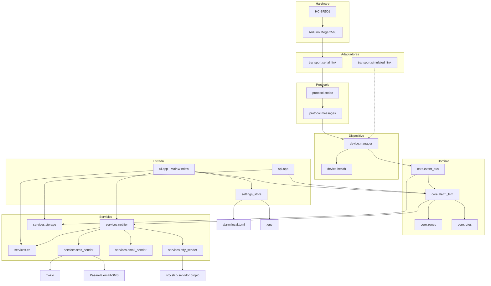
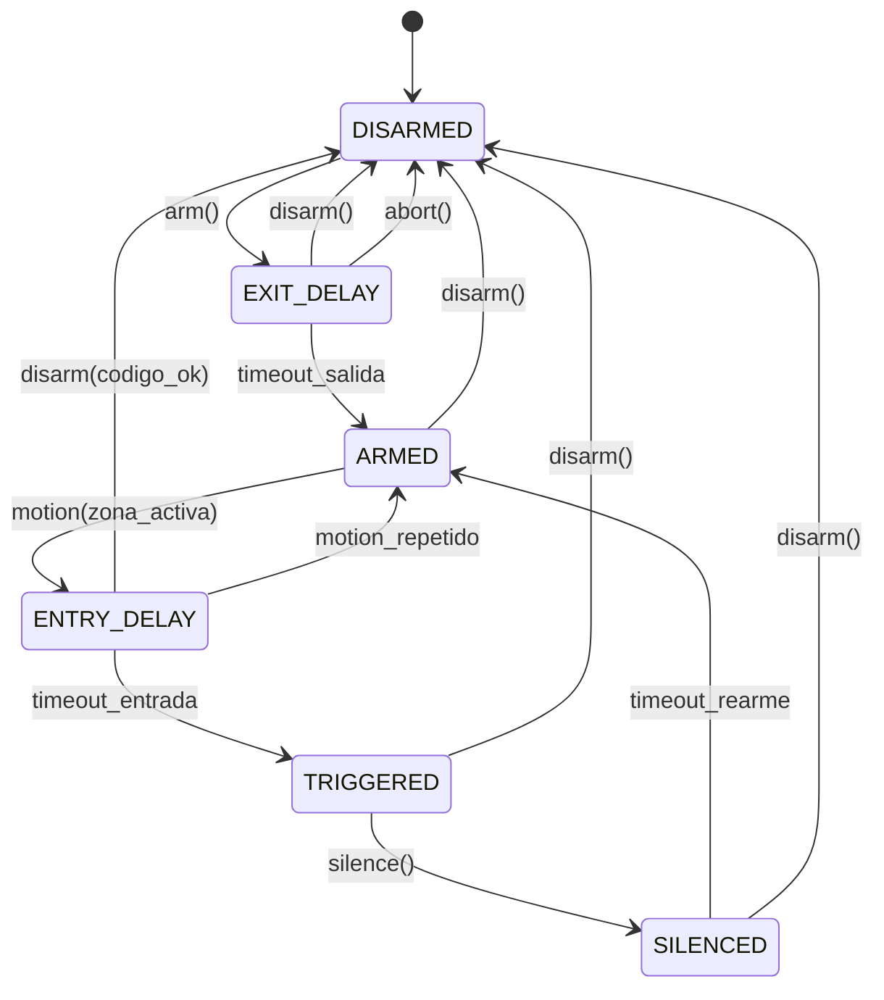

# Alarma de presencia con Arduino Mega 2560 — Documento de premisas y arquitectura

| Campo | Valor |
|---|---|
| Documento | `doc/00-PREMISAS.md` |
| Versión | 1.0 |
| Fecha | 2026-11-10 |
| Estado | Aprobado como base de diseño (fase F0) |
| Ámbito | Detección de presencia en vivienda mediante HC-SR501 + Arduino Mega 2560 + software Windows |
| Audiencia | Desarrollo, montaje y mantenimiento del sistema |

---

## Índice

1. [Visión y alcance](#1-visión-y-alcance)
2. [Requisitos](#2-requisitos)
3. [Hardware y cableado](#3-hardware-y-cableado)
4. [Firmware: Firmata o programa a medida](#4-firmware-firmata-o-programa-a-medida)
5. [Arquitectura del software del PC](#5-arquitectura-del-software-del-pc)
6. [Estructura de carpetas](#6-estructura-de-carpetas)
7. [Máquina de estados de la alarma](#7-máquina-de-estados-de-la-alarma)
8. [Modelo de datos](#8-modelo-de-datos)
9. [Configuración](#9-configuración)
10. [Seguridad y privacidad](#10-seguridad-y-privacidad)
11. [Hoja de ruta por fases](#11-hoja-de-ruta-por-fases)
12. [Registro de decisiones (ADR) y preguntas abiertas](#12-registro-de-decisiones-adr-y-preguntas-abiertas)
13. [Glosario](#13-glosario)

---

## 1. Visión y alcance

### 1.1 Visión

Sistema doméstico de **detección de presencia no autorizada** compuesto por dos piezas que se comunican de forma continua por USB:

- Un **Arduino Mega 2560** con un sensor de movimiento **HC-SR501 (PIR)** enchufado permanentemente por USB al PC. Su única responsabilidad es *detectar* y *reportar* eventos con precisión temporal, y sobrevivir sin bloquearse.
- Un **software en Windows** que decide qué es un evento relevante, mantiene el estado de la alarma (armada/desarmada), avisa por **voz** y por **mensajería**, y deja **traza auditable** de todo lo ocurrido.

La separación es deliberada: el Arduino no contiene reglas de negocio y el PC no contiene lógica de tiempo real. Cada lado hace bien una cosa.

### 1.2 Objetivo de esta fase (F0)

Fijar las premisas que no deben cambiar a la ligera: alcance, cableado, protocolo, arquitectura por capas, modelo de datos y hoja de ruta. **No se escribe todavía código de producción.** El código empieza en F1 con el firmware y el simulador.

### 1.3 Alcance funcional previsto

| Incluido | Excluido (por ahora) |
|---|---|
| Detección de movimiento por PIR y reporte inmediato al PC | Reconocimiento de personas (cámaras, biometría) |
| Armado/desarmado manual desde la ventana de la aplicación, bandeja y panel web local | Teclado físico o mando de radiofrecuencia |
| Mando remoto por ntfy desde el móvil: armar, desarmar, consultar y silenciar | Control desde fuera de casa sin VPN ni ntfy |
| Retardos de entrada y salida configurables | Geofencing con el móvil |
| Aviso por voz sintetizada, con texto, retardo y repeticiones por evento | Sirena de potencia (se deja preparada la salida) |
| Aviso por correo a varios destinatarios, por SMS (Twilio o pasarela del operador) y push al móvil con ntfy | Mensajería instantánea (Telegram) e integración con asistentes de voz |
| Registro de eventos en SQLite, exportable a CSV | Alta disponibilidad con redundancia de hardware |
| Estado del enlace serie y detección de caída del Arduino | Conexión a la nube o acceso remoto sin VPN |

### 1.4 Límites que hay que asumir de forma explícita

- Un **PIR detecta movimiento térmico, no identidad**. No distingue una persona de un animal grande ni de una corriente de aire caliente. Las decisiones de la sección 3.5 son parte del diseño, no un detalle.
- El sistema **depende del PC encendido** y de que Windows no entre en suspensión. Si el PC se apaga, se pierden las notificaciones remotas (el Arduino puede seguir detectando y guardar en su buffer, pero no avisar).
- Un corte de luz deja el sistema inoperativo salvo que se añada SAI (ver preguntas abiertas).
- Es un sistema **disuasorio y de aviso**, no un sistema certificado de seguridad. No debe ser el único medio para proteger personas.

### 1.5 Principios de diseño

1. **Modularidad por puertos y adaptadores.** Las capas altas nunca conocen si el dispositivo es real o simulado, ni si el aviso sale por Telegram o por Twilio.
2. **El PC es la fuente de verdad temporal.** El Arduino reporta `millis()`, el PC sella con hora UTC.
3. **Fallo ruidoso, nunca silencioso.** Si el enlace cae, si el PIR no está listo o si un aviso no se pudo enviar, se registra y se muestra en la UI.
4. **Todo configurable sin recompilar.** Umbrales, textos de voz, destinatarios y horarios viven en configuración.
5. **Nada de secretos en el repositorio.** Credenciales en `.env`, nunca en YAML versionado.
6. **Nunca bloquear el bucle de eventos.** TTS, correo y SMS se ejecutan fuera del hilo de recepción serie.

---

## 2. Requisitos

### 2.1 Requisitos funcionales

| ID | Requisito |
|---|---|
| RF-01 | El sistema detectará movimiento mediante al menos un PIR y lo reportará al PC en menos de 1 s desde el flanco de salida del sensor. |
| RF-02 | El sistema admitirá armar y desarmar desde la ventana principal de la aplicación (un solo botón grande) y, más adelante, desde el panel web local. |
| RF-03 | Al armar existirá un retardo de salida configurable (por defecto 45 s, `0` lo desactiva) durante el cual las detecciones no disparan la alarma. |
| RF-04 | Al detectar movimiento en estado armado se iniciará un retardo de entrada configurable (por defecto 30 s, `0` lo desactiva) antes de considerarlo intrusión. |
| RF-05 | Cada evento de voz (armada, desarmada, disparada…) tendrá texto, etiqueta de pantalla, retardo y repeticiones configurables, y podrá probarse desde su propio diálogo. |
| RF-06 | Al confirmarse la intrusión se enviará un aviso a uno o varios destinatarios por los canales habilitados (correo, SMS y push al móvil con ntfy), con reintentos y sin bloquear la ventana. |
| RF-07 | Los avisos estarán sujetos a enfriamiento (*cooldown*) y a un límite máximo por hora para evitar tormentas de mensajes. |
| RF-08 | Todo evento (detección, cambio de estado, aviso enviado o fallido, conexión o caída del dispositivo) se persistirá con hora UTC y hora local. |
| RF-09 | El log será consultable en el panel web, filtrable y exportable a CSV. |
| RF-10 | El sistema admitirá varias zonas (sensores) sin cambios de arquitectura; la primera versión define una zona. |
| RF-11 | El sistema permitirá silenciar una alarma activa sin desarmar el sistema. |
| RF-12 | El sistema notificará en la UI cuando el Arduino esté desconectado o el PIR esté en periodo de calentamiento. |
| RF-13 | El sistema se reiniciará automáticamente al iniciar sesión en Windows. |
| RF-14 | El sistema podrá simular el dispositivo para desarrollo y pruebas sin hardware conectado. |
| RF-15 | La configuración editada desde la aplicación se guardará en `config/alarm.local.toml`, sin reescribir ni perder los comentarios de `config/alarm.toml`. |
| RF-16 | Las credenciales (SMTP, Twilio) se guardarán solo en `.env` y nunca se mostrarán de vuelta en la interfaz. |
| RF-17 | El correo de contacto del autor estará visible en **Ayuda → Acerca de**, con enlace `mailto:` y botón de copiar. |
| RF-18 | La interfaz mostrará una ayuda contextual al pasar el ratón por cada control relevante. |
| RF-19 | El sistema mantendrá el enlace con el Arduino de forma permanente: reconectará solo (incluido un cambio de puerto COM), vigilará los latidos, mostrará el estado en el botón de conexión y avisará por registro, voz, correo y SMS cuando se pierda el enlace. |
| RF-20 | El registro de eventos se guardará en SQLite con retención de 1 año o 100.000 eventos, se mostrará limitado en pantalla y se podrá exportar a CSV (UTF-8 con BOM) desde la ventana. |
| RF-21 | El sistema aceptará órdenes remotas por ntfy (`armar`, `desarmar`, `consultar`, `silenciar` y, opcionalmente, `panico`) en un tema distinto del de avisos, autenticadas con clave o TOTP, con bloqueo por fallos y respuesta al móvil. Solo se ejecutan las órdenes posteriores al arranque. |

### 2.2 Requisitos no funcionales

| ID | Requisito |
|---|---|
| RNF-01 | Latencia extremo a extremo detección → aviso de voz inferior a 2 s en condiciones normales. |
| RNF-02 | Funcionamiento continuo 24×7 sin fugas de memoria ni crecimiento descontrolado del log (rotación y purga). |
| RNF-03 | Reconexión automática del puerto serie con retroceso exponencial; el sistema no requiere reinicio manual. |
| RNF-04 | El hilo de recepción serie nunca se bloquea por operaciones de red, disco o audio. |
| RNF-05 | Consumo en reposo del software inferior a 300 MB de RAM (incluye Qt) y 3 % de CPU. |
| RNF-06 | El panel web escucha únicamente en `127.0.0.1` y exige token. |
| RNF-07 | Los secretos no aparecen en el repositorio ni en los logs, ni se devuelven a la interfaz. |
| RNF-08 | Código tipado (`mypy` en modo estricto razonable), formateado con `ruff`, con pruebas unitarias de la máquina de estados, del códec, de la configuración en dos capas y de los canales de aviso. |
| RNF-09 | Instalación reproducible en un solo paso y ejecución sin privilegios de administrador. |
| RNF-10 | El sistema debe arrancar y quedar operativo en menos de 10 s desde el inicio de sesión. |

### 2.3 Requisitos de hardware y entorno

| ID | Requisito |
|---|---|
| RH-01 | Arduino Mega 2560 (ATmega2560) con cable USB de datos. |
| RH-02 | Módulo HC-SR501 alimentado desde el pin `5V` del Mega, dentro de su rango de 5–20 V DC. |
| RH-03 | PC con Windows 10/11, Python 3.13, al menos un puerto USB libre y audio funcional. |
| RH-04 | El PC no debe suspender ni hibernar mientras la alarma esté armada. |
| RH-05 | El cableado del sensor no debe superar 3 m; por encima, cable apantallado. |

---

## 3. Hardware y cableado

### 3.1 Componentes

| Componente | Cantidad | Notas |
|---|---|---|
| Arduino Mega 2560 | 1 | Clones con CH340 requieren driver; los originales usan ATmega16U2. |
| Módulo HC-SR501 (PIR) | 1 | Salida digital de 3,3 V, alimentación 5–20 V DC, consumo en reposo del orden de decenas de µA. |
| Cables dupont hembra-hembra | 3 | Preferible 20 cm; si el sensor va lejos, cable apantallado de 3 hilos. |
| Cable USB A-B | 1 | De datos, no solo de carga. |
| Fuente 9 V / 1 A (opcional) | 1 | Solo si el Mega se alimenta por jack; no conectar a la vez 5 V externos en el pin `5V`. |

### 3.2 Especificaciones del HC-SR501

Estos son los valores que publica el fabricante del módulo y los que el diseño debe respetar. Son la referencia para cualquier duda sobre tensiones; las cifras de foros y tutoriales suelen mezclar variantes distintas.

| Parámetro | Valor | Consecuencia para el diseño |
|---|---|---|
| Tensión de trabajo | **5–20 V DC** | El pin `5V` del Mega es válido pero está en el **borde inferior** del rango; el pin `3.3V` queda fuera. |
| Nivel de salida | Alto ≈ 3,3 V / Bajo ≈ 0 V | Entra en `D2` por encima del umbral de 3,0 V del ATmega2560, con margen justo. |
| Corriente en reposo | Decenas de µA (típ. <50 µA) | Irrelevante para la alimentación; no añade carga apreciable al regulador. |
| Alcance de detección | Hasta ~7 m, cono ~110° | Un solo sensor cubre un pasillo o una estancia; no un piso entero. |
| Retardo configurable (`Tx`) | ~0,3 s a ~18 s (según variante) | Ponerlo al mínimo; el tiempo se gestiona en el PC. |
| Tiempo de bloqueo | ~0,2 s tras cada pulso | No intentar detectar eventos más rápidos que eso en el módulo. |
| Tiempo de estabilización | ~50 s tras alimentar | Coincide con el calentamiento de 60 s que aplica el firmware. |
| Temperatura de trabajo | −15 °C a +70 °C | Adecuado para interior; no montar en exterior ni junto a fuentes de calor. |
| Modos de disparo | `H` repetitivo / `L` no repetitivo | Usar `H`. |

### 3.3 Conexión del HC-SR501 al Mega 2560

| HC-SR501 | Arduino Mega 2560 | Motivo |
|---|---|---|
| `VCC` | pin `5V` | El módulo admite **5–20 V DC**; el pin `3.3V` del Mega **no sirve** porque queda por debajo del mínimo de 5 V. |
| `OUT` | pin digital `2` | Pin con interrupción externa (INT4) en el Mega; permite capturar flancos sin sondeo. |
| `GND` | pin `GND` | Masa común. |

```
        HC-SR501                          Arduino Mega 2560
    ┌───────────────┐                    ┌───────────────────┐
    │  VCC  ●───────┼────────────────────┤ 5V                │
    │  OUT  ●───────┼────────────────────┤ D2  (INT4)        │
    │  GND  ●───────┼────────────────────┤ GND               │
    └───────────────┘                    │            USB ═══╪═══ PC
                                         └───────────────────┘
```

**Verificar siempre la serigrafía del módulo antes de alimentar.** La mayoría de HC-SR501 llevan impresas las etiquetas `VCC`, `OUT` y `GND` junto a los pines; el orden físico varía entre clones, así que no se debe deducir por la posición. Si no hay serigrafía, identificar `GND` por continuidad con el plano de masa del módulo con un polímetro. **Invertir VCC y GND destruye el módulo de forma instantánea.**

### 3.4 Notas eléctricas

- **Tensión de alimentación.** La especificación del módulo es **5–20 V DC**, con salida digital de 3,3 V y umbral térmico independiente de la tensión de entrada. Alimentado a 5 V se trabaja en el **límite inferior** del rango: es válido, pero deja poco margen frente a caídas del raíl de 5 V por cable USB largo o de mala calidad. Si se observan reinicios o detecciones fantasma, medir la tensión en los pines del módulo; por debajo de ~4,8 V conviene acortar el cable o alimentar `VCC` desde `VIN` con un jack de 9 V en el Mega (sigue dentro de rango), manteniendo `OUT` en `D2`.
- **Nivel lógico.** La salida del HC-SR501 es de 3,3 V. El ATmega2560 alimentado a 5 V tiene umbral de entrada alto \(V_{IH} = 0{,}6 \times V_{CC} = 3{,}0\ \text{V}\). Funciona, pero con solo 0,3 V de margen. Si aparecen lecturas erráticas, intercalar un buffer **74AHCT125** (recomendado) o un transistor con resistencia de pull-up. No usar un divisor resistivo: bajaría el nivel por debajo del umbral.
- **Ruido.** Añadir un condensador cerámico de **100 nF** entre `VCC` y `GND` del módulo, lo más cerca posible de los pines, si el cable supera 50 cm o hay motores, fluorescentes o routers cerca.
- **Corriente.** El consumo en reposo es de **decenas de microamperios** (las hojas del módulo suelen indicar <50 µA) y sube solo unos pocos miliamperios con la salida activa. Es irrelevante para el regulador del Mega, que puede entregar cientos de miliamperios por el raíl de 5 V. Aun así, no alimentar además relés o sirenas desde ese pin: usar fuente aparte con masa común.
- **Alimentación doble.** Con USB conectado al PC, **no** inyectar 5 V externos en el pin `5V`. Si se usa jack de 9 V junto al USB, el Mega conmuta automáticamente y es seguro.
- **Ubicación.** Alejado de routers Wi-Fi, transformadores, rejillas de aire acondicionado, radiadores y de la luz solar directa. La lente no debe apuntar a ventanas ni a la calle.

### 3.5 Ajuste y montaje del PIR

- **Calentamiento.** Tras alimentar, el módulo necesita **30–60 s** de estabilización con la salida en bajo/errático. El firmware debe ignorar detecciones durante ese periodo y el PC mostrarlo como *calentando*.
- **Altura y orientación.** Entre 2,0 y 2,2 m, con inclinación de unos 30–45°. Los PIR detectan mejor el movimiento **transversal** a la lente: colocar el sensor de forma que la persona cruce su campo de visión, no que venga de frente.
- **Alcance.** Hasta ~7 m y ~110° de cono. Reducir si hay mascotas.
- **Jumper `H` / `L`.** `H` = disparo repetitivo (la salida se mantiene alta mientras haya movimiento), `L` = pulso único (baja al terminar el retardo aunque haya movimiento). **Usar `H`**: el firmware interpreta el flanco de subida como inicio y el de bajada como fin de actividad, y es más tolerante a falsos reinicios.
- **Potenciómetro `Tx` (retardo).** Girar **al mínimo**. En el módulo estándar el rango va de ~0,3 s a ~18 s según la variante, con un tiempo de bloqueo (*trigger prohibiting*) de ~0,2 s tras cada pulso. Los temporizadores largos ocultan eventos y confunden la lógica del PC. El tiempo relevante lo gestiona el software.
- **Potenciómetro `Sx` (sensibilidad).** Empezar al 60 % y ajustar en pruebas reales.
- **Falsos positivos típicos:** mascotas, cortinas con sol, aire acondicionado dirigido al sensor, insectos sobre la lente, cables de alimentación paralelos al cable de señal. Documentar en el log qué zona y a qué hora se dispara ayuda a diagnosticarlos.

### 3.6 Riesgos conocidos del hardware

| Riesgo | Mitigación |
|---|---|
| El puerto COM cambia de número al cambiar de USB | Identificar por VID/PID y número de serie (`pyserial list_ports`); nunca fijar `COM3` a ciegas. |
| Windows suspende el puerto USB selectivamente | Desactivar la suspensión selectiva USB en el plan de energía. |
| El Arduino se reinicia al abrir el puerto (DTR) | El firmware debe enviar `hello` al arrancar y el PC debe tolerar el reseteo como algo normal. |
| Cable USB de solo carga | Verificar que aparece como puerto serie; si no, cambiar cable. |
| Microcortes de alimentación | SAI en el PC; ver preguntas abiertas. |

---

## 4. Firmware: Firmata o programa a medida

### 4.1 Qué es Firmata

Firmata es un protocolo genérico que convierte el Arduino en un **extensor de pines controlado desde el PC**: el PC envía órdenes como «pon el pin 13 en alto» o «notifícame cuando el pin 2 cambie», y la librería estándar (`StandardFirmata`) las ejecuta. En Python se usa con `pyFirmata` o `pyFirmata2`.

### 4.2 Comparativa aplicada a este proyecto

| Criterio | Firmata (`StandardFirmata`) | Firmware a medida |
|---|---|---|
| Puesta en marcha | Inmediata: cargar sketch de ejemplo y abrir el puerto | Requiere escribir y flashear un sketch (~150 líneas) |
| Lógica del sensor | En el PC: hay que sondear o escuchar flancos por red | En el Arduino: interrupción, antirrebote y filtrado local |
| Latencia y jitter | Mayor: cada cambio viaja como mensaje de protocolo genérico | Baja y determinista |
| Robustez ante caída del PC | Nula: el Arduino no hace nada útil sin PC | Puede guardar eventos en un buffer circular y activar avisos locales |
| Reconexión | Al reconectar se pierde el estado y hay que reconfigurar pines | Handshake propio, configuración persistida en EEPROM |
| Diagnóstico | No hay heartbeat ni números de secuencia | Heartbeat, `seq`, `ack` y códigos de error |
| Ampliación (multizona, sirena, teclado) | Cada elemento nuevo es más tráfico y más lógica en Python | Un mensaje de evento por zona; escalado natural |
| Dependencia | `pyFirmata` + firmware estándar ajeno | Código propio bajo nuestro control |
| Riesgo de seguridad | Cualquiera con acceso al puerto controla pines | Superficie mínima: solo los comandos definidos |

### 4.3 Decisión

**Se implementa firmware a medida. Firmata queda descartado como base del sistema.**

Motivos, por orden de peso:

1. **La lógica de detección pertenece al dispositivo.** Un PIR requiere antirrebote, filtrado del calentamiento y detección de flancos; hacerlo por USB añade una vía de fallo innecesaria.
2. **Trazabilidad.** Necesitamos saber si un evento se perdió, si el dispositivo se reinició o si lleva 40 s sin latir. Eso exige un protocolo con secuencia y heartbeat, que Firmata no ofrece.
3. **Escalabilidad.** El usuario ha declarado que el sistema crecerá. Añadir zonas, una sirena o un teclado con Firmata obliga a mover cada vez más lógica al PC y a manejar un protocolo que no controlamos.
4. **Coste real.** El firmware a medida de F1 son unas 150 líneas de C++ no bloqueante. La diferencia de esfuerzo es marginal y el beneficio estructural es grande.

**Uso legítimo de Firmata:** únicamente como **prueba de banco** de 5 minutos para verificar que el PIR y el cableado funcionan (cargar `StandardFirmata`, abrir el puerto y ver el pin 2 cambiar). No forma parte del producto y no se versiona.

### 4.4 Diseño del firmware

- **Sin `delay()`.** Bucle `loop()` no bloqueante; temporización con `millis()`.
- **Interrupción** en el pin 2 para `RISING` y `FALLING`; el manejador solo marca una bandera y sella `millis()`.
- **Antirrebote** de 50 ms en el bucle principal.
- **Estado de calentamiento** de 60 s tras el arranque: no se emiten eventos de intrusión, solo `warmup`.
- **Buffer circular** de 32 eventos pendientes hasta recibir confirmación del PC; si se llena, descarta los más antiguos y lo reporta con un contador de descartes.
- **Watchdog** de 8 s (`wdt_enable`) para recuperarse de un bloqueo.
- **Configuración en EEPROM** (retardo mínimo entre eventos, pin de zona, LED de estado, flag de calentamiento) con *checksum* y valores por defecto si está corrupta.
- **LED de estado** en el pin 13 del propio Arduino: parpadeo lento = esperando PC, fijo = enlazado, destello = evento emitido.
- **Longitud máxima de línea** de 256 bytes; las líneas más largas se descartan y se reporta error.

---

## 5. Arquitectura del software del PC

### 5.1 Vista por capas



### 5.2 Responsabilidad de cada módulo

| Módulo | Responsabilidad | No debe hacer |
|---|---|---|
| `transport.serial_link` | Abrir y mantener el puerto, leer líneas, reconectar con retroceso exponencial, enumerar puertos por VID/PID y volver a resolver el puerto si el `COMx` guardado desaparece | Interpretar mensajes ni decidir nada |
| `transport.simulated_link` | Implementación del mismo puerto para desarrollo: genera eventos sintéticos | Existir en producción |
| `protocol.messages` | Modelos tipados (`Hello`, `Heartbeat`, `MotionEvent`, `Ack`, `Command`) | Tocar el puerto |
| `protocol.codec` | Serializar y deserializar NDJSON, validar esquema, descartar líneas corruptas | Contener reglas de negocio |
| `device.manager` | Handshake, envío de configuración, deduplicación por `seq`, envío de `ack`, watchdog del heartbeat y transiciones de salud con `ever_online` y `next_retry_in` | Decidir si hay intrusión |
| `device.health` | Estado del enlace (`ONLINE`, `DEGRADED`, `OFFLINE`), contadores de pérdida | Notificar directamente |
| `core.event_bus` | Publicación/suscripción tipada en proceso | Ser un bus distribuido |
| `core.alarm_fsm` | Máquina de estados de la alarma, retardos y transiciones | Enviar mensajes ni escribir en disco |
| `core.zones` | Estado por zona: calentando, último evento, enfriamiento | Conocer el protocolo serie |
| `core.rules` | Filtros: horarios, enfriamiento, límites, zonas excluidas | Persistir |
| `services.notifier` | Orquestar avisos, aplicar plantillas, reintentos y deduplicación | Implementar protocolos de terceros |
| `services.tts` | Reproducir voz por SAPI, con cola, retardo y repeticiones por evento | Bloquear el hilo llamador |
| `services.sms_sender` | Proveedores SMS intercambiables: Twilio por HTTP y pasarela correo-a-SMS | Elegir proveedor (lo hace `SmsSwitch` según configuración) |
| `services.ntfy_sender` | Publicar avisos push en un tema de ntfy (JSON sobre HTTPS, servidor público o propio con token) | Decidir qué eventos avisan (eso lo filtra `NtfyConfig.enabled_for`) |
| `services.ntfy_commands` | Decodificar órdenes del móvil, autenticarlas, bloquear fallos y escuchar el tema de mando | Ejecutar el controlador, la base ni tocar widgets |
| `services.totp` | Códigos TOTP RFC 6238, ventana y anti-repetición | Guardar secretos |
| `services.storage` | Registro persistente en SQLite (`log_entries`), retención por edad y número, consulta y exportación CSV | Contener lógica de alarma |
| `settings_store` | Serializar la configuración a `alarm.local.toml` de forma atómica | Validar reglas de negocio |
| `secrets` | Actualizar `.env` conservando comentarios y claves ajenas | Registrar valores |
| `api.app` | FastAPI + panel estático + token, estado, eventos, armar/desarmar | Hablar con el puerto serie |
| `ui.app` | Ventana PyQt6: hero de estado, tarjetas, registro, diálogos modales | Tocar el puerto serie o bloquear el hilo de UI |
| `ui.bridge` | Convertir mensajes del hilo del dispositivo en señales Qt | Decidir transiciones |
| `ui.dialogs.*` | Configurar voz, avisos, resultado y Acerca de; guardar en dos capas | Enviar correo o hablar desde el hilo de UI |
| `__main__` | Composición de dependencias y arranque ordenado | Tener lógica propia |

### 5.3 Comunicación entre componentes

- **Dentro del proceso:** bus de eventos en memoria con suscriptores tipados. El hilo serie publica; la FSM, la persistencia y la UI consumen. Ningún consumidor puede bloquear al publicador: los servicios lentos corren en un ejecutor o en su propio hilo con cola acotada.
- **Fuera del proceso:** único punto de entrada el panel web en `127.0.0.1`. Sin sockets remotos en la primera versión.
- **Modelo de concurrencia:** un hilo de lectura serie, un hilo de la API/uvicorn, el hilo de Qt y una cola de trabajo para avisos. La FSM se ejecuta en un único hilo (el del bus) para evitar condiciones de carrera sobre el estado. La UI nunca recibe llamadas directas desde otro hilo: `ui/bridge.py` las convierte en señales Qt, que se entregan en el hilo de la ventana.

### 5.4 Interfaces (puertos) clave

```python
class SerialLink(Protocol):
    def open(self) -> None: ...
    def close(self) -> None: ...
    def read_line(self, timeout: float) -> str | None: ...
    def write_line(self, line: str) -> None: ...
    @property
    def is_open(self) -> bool: ...

class Channel(Protocol):
    """Un canal de aviso: correo, SMS, ntfy..."""
    @property
    def name(self) -> str: ...
    @property
    def enabled(self) -> bool: ...
    @property
    def configured(self) -> bool: ...
    def enabled_for(self, cause: str) -> bool: ...
    def send(self, subject: str, body: str) -> DeliveryResult: ...

class EventRepository(Protocol):
    def append(self, event: DomainEvent) -> int: ...
    def recent(self, limit: int, filters: dict) -> list[DomainEvent]: ...
    def export_csv(self, path: Path) -> int: ...
```

Sustituir cualquiera de estas implementaciones (por ejemplo, pasar de SQLite a PostgreSQL o de Stripe a Vonage) no debe tocar el dominio. Ese es el criterio para saber si la modularidad está bien hecha.

### 5.5 Rendimiento y recursos

- Lectura serie en modo bloqueante con `timeout=0.2 s` dentro de un hilo dedicado; nunca `poll()` en bucle cerrado.
- Colas acotadas (`maxsize`) en todos los traspasos entre hilos; si se llenan, se registra la pérdida en lugar de crecer sin límite.
- El TTS puede tardar segundos: se ejecuta en un hilo propio con cola de profundidad 3 y descarte del mensaje más antiguo.
- SQLite en modo WAL, `synchronous=NORMAL`, una conexión por hilo y escritura por lotes cuando haya ráfagas.

---

## 6. Estructura de carpetas

Estructura objetivo al final de F4. Cada fase crea solo lo que necesita.

```
Alarma Casa con Arduino/
├─ doc/
│  ├─ 00-PREMISAS.md              # este documento
│  ├─ 01-HARDWARE.md              # (F1) fotos, medidas, ajustes del PIR
│  ├─ 02-PROTOCOLO.md             # (F1) referencia del protocolo serie
│  ├─ 03-AVISOS.md                # (F1.3) voz, correo, SMS, móvil, mando remoto y zumbador
│  ├─ 04-INTERFAZ.md              # (F1.4) ventana, diálogos, atajos e iconos
│  └─ img/                        # capturas generadas con tools/ui_preview.py
├─ firmware/
│  └─ mega-pir/
│     ├─ mega-pir.ino             # sketch: misma carpeta = mismo nombre (requisito de Arduino)
│     └─ build/                   # gitignored: artefactos de compilación
├─ src/
│  └─ alarm/
│     ├─ __init__.py
│     ├─ __main__.py              # composición y arranque
│     ├─ paths.py                 # HECHO: raíz de datos dentro y fuera del .exe
│     ├─ config.py                # HECHO: TOML + .env con tomllib y dos capas
│     ├─ settings_store.py        # HECHO: escribe alarm.local.toml de forma atomica
│     ├─ secrets.py               # HECHO: actualiza .env conservando el resto
│     ├─ config_export.py         # HECHO: volcado JSON sin credenciales
│     ├─ backup.py                # HECHO: copia completa y restauración con secretos
│     ├─ logging_setup.py         # log rotativo, redacción de secretos
│     ├─ core/
│     │  ├─ events.py
│     │  ├─ event_bus.py
│     │  ├─ alarm_fsm.py
│     │  ├─ state.py              # HECHO: maquina de estados, retardos y limites de aviso
│     │  ├─ zones.py
│     │  └─ rules.py
│     ├─ protocol/
│     │  ├─ messages.py           # HECHO: modelos tipados inmutables
│     │  └─ codec.py              # HECHO: decodificador estricto y codificador
│     ├─ transport/
│     │  ├─ base.py               # HECHO: puerto Link
│     │  ├─ serial_link.py        # HECHO: pyserial con buffer persistente
│     │  └─ simulated_link.py     # HECHO: dispositivo falso en proceso
│     ├─ device/
│     │  ├─ manager.py            # HECHO: handshake, acuses, salud, reconexión
│     │  └─ calibrator.py         # HECHO: modo de ajuste y diagnóstico
│     ├─ services/
│     │  ├─ base.py               # HECHO: protocolo Channel y DeliveryResult
│     │  ├─ notifier.py           # HECHO: cola de avisos y compuerta de limites
│     │  ├─ tts.py                # HECHO: voz SAPI con cache, retardo y repeticiones
│     │  ├─ email_sender.py       # HECHO: canal SMTP con reintentos
│     │  ├─ sms_sender.py         # HECHO: Twilio y pasarela email-SMS
│     │  ├─ ntfy_sender.py        # HECHO: avisos push por ntfy (JSON + Bearer)
│     │  ├─ ntfy_commands.py      # HECHO: ordenes del movil, bloqueo y listener
│     │  ├─ totp.py               # HECHO: TOTP RFC 6238 en Python puro
│     │  ├─ audio.py              # HECHO: pitidos del PC con winsound
│     │  └─ storage.py            # HECHO: historial SQLite, retención y CSV
│     ├─ api/
│     │  ├─ app.py
│     │  ├─ routes.py
│     │  ├─ auth.py
│     │  └─ static/               # panel web (HTML/CSS/JS mínimo)
│     └─ ui/
│        ├─ app.py                # HECHO: MainWindow PyQt6
│        ├─ theme.py              # HECHO: QSS, paleta y estados del hero
│        ├─ icons.py              # HECHO: SVG rasterizado con color dinamico
│        ├─ widgets.py            # HECHO: Card, StateHero, ConnectionChip, EventLog
│        ├─ bridge.py             # HECHO: hilo de serie -> senales Qt
│        ├─ calibration.py        # HECHO: asistente de ajuste en QDialog
│        ├─ audio.py              # HECHO: pruebas de sonido sin toolkit
│        ├─ assets/icons/*.svg    # HECHO: escudo, campana, correo, SMS, movil, USB...
│        ├─ dialogs/
│        │  ├─ common.py          # HECHO: base de dialogo y editor de destinatarios
│        │  ├─ voice_config.py     # HECHO: tabla de avisos, voz, tiempos y registro
│        │  ├─ notifications.py   # HECHO: pestanas de correo, SMS y movil (ntfy)
│        │  ├─ remote.py          # HECHO: mando remoto, clave, TOTP y estado
│        │  ├─ result.py          # HECHO: resultado de una prueba
│        │  └─ about.py           # HECHO: version, hardware y contacto
│        └─ tray.py               # (F2) icono en la bandeja del sistema
├─ config/
│  ├─ alarm.example.toml          # HECHO: plantilla versionada
│  ├─ alarm.local.toml            # (F1.4) overrides escritos desde la app, gitignored
│  └─ logging.yaml
├─ data/                          # gitignored: alarm.db, exports, capturas serie
├─ tests/
│  ├─ conftest.py                 # HECHO: QApplication offscreen de sesion
│  ├─ test_codec.py               # HECHO
│  ├─ test_calibrator.py          # HECHO
│  ├─ test_config.py              # HECHO: dos capas, eventos y SMS
│  ├─ test_settings_store.py      # HECHO: ida y vuelta TOML y .env atomico
│  ├─ test_tts.py                 # HECHO: retardo, repeticiones y cancelacion
│  ├─ test_sms.py                 # HECHO: Twilio con transporte falso y pasarela
│  ├─ test_ntfy.py                # HECHO: payload JSON, prioridades, reintentos y token
│  ├─ test_remote_commands.py     # HECHO: gramatica, clave, TOTP, bloqueo y avisos
│  ├─ test_remote_listener.py     # HECHO: cursor, duplicados, respuestas y stop
│  ├─ test_totp.py                # HECHO: vectores RFC 6238, ventana y repeticion
│  ├─ test_notifier.py            # HECHO: filtrado por causa
│  ├─ test_ui.py                  # HECHO: ventana, dialogos y armar/desarmar
│  ├─ test_serial_link.py         # HECHO: redeteccion de puerto por VID/PID
│  ├─ test_device_manager.py      # HECHO: salud, ever_online y reintentos
│  ├─ test_storage.py             # HECHO: SQLite, purga por edad/numero y CSV
│  ├─ test_backup.py              # HECHO: copia completa, validacion y restauracion
│  ├─ test_paths.py               # HECHO: raiz de datos dentro y fuera del .exe
│  ├─ test_alarmctl_log.py        # HECHO: consulta del historial por consola
│  ├─ test_alarmctl_backup.py     # HECHO: copia y restauracion por consola
│  └─ test_fsm.py
├─ packaging/
│  ├─ alarma.spec                 # HECHO: PyInstaller, un solo fichero
│  └─ launcher.py                 # HECHO: entrada del .exe sin consola
├─ tools/
│  ├─ alarmctl.py                 # HECHO: info, monitor, calibrate, ports, log, backup
│  ├─ sim_device.py               # HECHO: dispositivo simulado por stdin/stdout
│  ├─ make_assets.py              # HECHO: icono .ico y version para el .exe
│  ├─ ui_preview.py               # HECHO: capturas offscreen a doc/img
│  └─ serial_watch.ps1            # monitor serie sin dependencias (F1.0)
├─ scripts/
│  ├─ setup.ps1                   # HECHO: crea .venv e instala el paquete
│  ├─ build.ps1                   # HECHO: compila dist\AlarmaCasa.exe
│  ├─ flash.ps1                   # compila y sube el sketch (arduino-cli)
│  ├─ run.ps1                     # HECHO: arranca la aplicación
│  └─ register_task.ps1
├─ .vscode/
│  ├─ launch.json                 # HECHO: F5 arranca la aplicación
│  └─ settings.json               # HECHO: intérprete y pytest
├─ .env.example
├─ .gitignore
├─ pyproject.toml
└─ README.md
```

Reglas de organización:

- `src/alarm` es un paquete instalable; `tools` y `tests` no se empaquetan.
- Las dependencias apuntan **hacia dentro**: `api` y `ui` pueden importar `core` y `services`; `core` no importa nunca `api`, `ui` ni `serial`.
- Un módulo por responsabilidad; si un fichero supera ~300 líneas, probablemente haya dos responsabilidades dentro.
- `data/`, `.env` y el firmware compilado nunca entran en git.

---

## 7. Máquina de estados de la alarma

### 7.1 Estados

| Estado | Significado |
|---|---|
| `DISARMED` | Sistema desarmado. Las detecciones se registran como informativas y no generan alarma. |
| `EXIT_DELAY` | Armado en curso; cuenta atrás para salir. Aún no se dispara. |
| `ARMED` | Vigilando. Una detección inicia `ENTRY_DELAY`. |
| `ENTRY_DELAY` | Detección recibida; se espera a ver si el usuario desarma. |
| `TRIGGERED` | Intrusión confirmada. Voz y avisos activos. |
| `SILENCED` | Alarma reconocida: se detiene la voz, pero el sistema sigue armado y vigilando. |

La **salud del enlace** no es un estado de la FSM: es una dimensión ortogonal (`ONLINE`, `DEGRADED`, `OFFLINE`). Mezclarlas produciría una explosión de estados. Si el enlace cae estando armado, la FSM sigue en `ARMED` y la UI muestra el fallo.

### 7.2 Transiciones



| Transición | Evento disparador | Efecto |
|---|---|---|
| `DISARMED → EXIT_DELAY` | Orden `arm` | Arranca temporizador de salida, registra auditoría |
| `EXIT_DELAY → ARMED` | Temporizador cumplido | Pasa a vigilar |
| `ARMED → ENTRY_DELAY` | `motion` en zona activa y no en enfriamiento | Arranca temporizador de entrada |
| `ENTRY_DELAY → TRIGGERED` | Temporizador cumplido y enlace online | Dispara voz y avisos |
| `TRIGGERED → SILENCED` | Orden `silence` | Detiene voz; mantiene estado armado |
| `SILENCED → ARMED` | Temporizador de rearme (por defecto 300 s) | Vuelve a vigilar sin nuevos avisos dentro del enfriamiento |
| Cualquiera `→ DISARMED` | Orden `disarm` | Detiene todo y registra |

### 7.3 Reglas asociadas

- Una detección durante `EXIT_DELAY`, `DISARMED` o `SILENCED` **se registra siempre**, pero no dispara.
- `ENTRY_DELAY` recibiendo nuevo movimiento no reinicia la cuenta atrás salvo que la política `restart_entry_delay` esté activa (por defecto, **no**).
- `TRIGGERED` no reenvía avisos si ya se envió uno dentro de `cooldown_s` (por defecto 180 s) o si se superó `max_per_hour` (por defecto 6). El bloqueo se registra como evento para que nunca sea silencioso.
- `DISARMED` con detecciones genera un evento informativo con nivel `info`; sirve para diagnóstico de falsos positivos.

---

## 8. Modelo de datos

### 8.1 Motor

SQLite en `data/alarm.db`, modo WAL, `synchronous=NORMAL`, `foreign_keys=ON`. Una migración versionada desde el primer día (tabla `schema_version`). Suficiente para años de eventos domésticos y sin servidor que mantener.

### 8.2 Tablas

```sql
CREATE TABLE events (
    id            INTEGER PRIMARY KEY AUTOINCREMENT,
    ts_utc        TEXT    NOT NULL,       -- ISO 8601 con zona, fuente de verdad
    ts_local      TEXT    NOT NULL,       -- para lectura humana
    source        TEXT    NOT NULL,       -- 'device' | 'pc' | 'user' | 'system'
    type          TEXT    NOT NULL,       -- 'motion.start', 'alarm.triggered', ...
    severity      TEXT    NOT NULL,       -- 'debug' | 'info' | 'warning' | 'critical'
    zone          INTEGER,
    session_id    INTEGER REFERENCES device_sessions(id),
    seq           INTEGER,                -- seq del dispositivo, si aplica
    payload_json  TEXT,                   -- datos específicos del tipo
    dedup_key     TEXT UNIQUE             -- evita duplicados en reintentos
);
CREATE INDEX idx_events_ts ON events(ts_utc);
CREATE INDEX idx_events_type_ts ON events(type, ts_utc);

CREATE TABLE notifications (
    id            INTEGER PRIMARY KEY AUTOINCREMENT,
    event_id      INTEGER REFERENCES events(id),
    channel       TEXT NOT NULL,          -- 'tts' | 'email' | 'sms' | 'telegram' | 'push'
    provider      TEXT,                   -- 'email_to_sms' | 'twilio' | ...
    target        TEXT,                   -- destinatario ofuscado
    status        TEXT NOT NULL,          -- 'pending' | 'sent' | 'failed' | 'skipped'
    attempts      INTEGER NOT NULL DEFAULT 0,
    created_at    TEXT NOT NULL,
    sent_at       TEXT,
    error         TEXT
);

CREATE TABLE device_sessions (
    id            INTEGER PRIMARY KEY AUTOINCREMENT,
    started_at    TEXT NOT NULL,
    ended_at      TEXT,
    port          TEXT,
    device_id     TEXT,
    firmware      TEXT,
    end_reason    TEXT                    -- 'unplugged' | 'heartbeat_lost' | 'shutdown'
);

CREATE TABLE audit (
    id            INTEGER PRIMARY KEY AUTOINCREMENT,
    ts_utc        TEXT NOT NULL,
    actor         TEXT NOT NULL,          -- 'user' | 'system'
    action        TEXT NOT NULL,          -- 'arm' | 'disarm' | 'config.change'
    detail        TEXT
);

CREATE TABLE schema_version (
    version       INTEGER NOT NULL,
    applied_at    TEXT NOT NULL
);
```

### 8.3 Política de retención

- Registro de la ventana (`log_entries`, implementado en F1.5): 365 días **o**
  100.000 filas, lo que se cumpla primero, con purga al arrancar y cada 24 h. La
  ventana muestra las últimas `log.visible_rows` (1.000) y el resto se exporta a
  CSV. La tabla se llama `log_entries` y no `events` para no chocar con la tabla
  de dominio de F2.
- Eventos de nivel `debug`/`info` de tipos ruidosos: 90 días.
- Eventos `warning`/`critical` y auditoría: 2 años.
- Purga diaria a las 04:00 local; antes de borrar, rotación opcional a CSV en `data/archive/`.
- El log de aplicación (`logs/alarm.log`) usa rotación por tamaño (10 MB × 10) y **nunca** contiene secretos: el logger redacta tokens, contraseñas y números completos de teléfono.

---

## 9. Configuración

### 9.1 Separación

- `config/alarm.example.toml` — plantilla versionada, con comentarios.
- `config/alarm.toml` — configuración base; se crea copiando el ejemplo en el primer arranque y **no** se versiona.
- `config/alarm.local.toml` — capa de anulación escrita **solo** por la aplicación cuando se guarda desde un diálogo. Tampoco se versiona. Así los comentarios de `alarm.toml` no se pierden al tocar un ajuste desde la ventana.
- `.env` — credenciales y datos personales, **nunca** versionado. Plantilla en `.env.example`.
- Validación propia con mensajes concretos (`tts.volume debe estar entre 0 y 100`): si la configuración es inválida, la aplicación no arranca a medias.

Precedencia: valores por defecto < `alarm.toml` < `alarm.local.toml` < variables de entorno < argumentos de línea de comandos.

**Dónde viven estos ficheros.** En desarrollo, en la raíz del repositorio. En el
ejecutable empaquetado, junto al `.exe` (o en `%LOCALAPPDATA%\AlarmaCasa` si esa
carpeta no admite escritura), nunca en la carpeta temporal de PyInstaller. Lo
decide [`src/alarm/paths.py`](../src/alarm/paths.py), y *Acerca de* lo muestra
para que no haya que adivinarlo.

**Mudarse a otro PC.** `Archivo → Guardar copia completa (con credenciales)…`
escribe un `.alarmbackup` con las dos capas del TOML resueltas (incluidas
`serial` y `log`) más las claves de `.env` que tengan valor;
`Archivo → Restaurar copia completa…` lo aplica escribiendo **solo** la capa
local y actualizando `.env`, sin tocar `alarm.toml`. La copia lleva las
contraseñas en claro a propósito (ADR-029); el volcado JSON de soporte sigue
existiendo sin credenciales.

### 9.2 Esquema

El fichero vigente y comentado es [`config/alarm.example.toml`](../config/alarm.example.toml). Bloques implementados en F1.4 y F1.5:

```toml
[serial]
port = "auto"
baudrate = 115200
auto_connect = true         # conectar sola al arrancar y mantener el enlace
reconnect_max_s = 30        # espera máxima entre reintentos (retroceso exponencial)
heartbeat_timeout_s = 8     # sin datos durante 8 s: enlace perdido (4 latidos)

[alarm]
armed_on_start = false
cooldown_s = 180        # mínimo entre avisos de la misma causa
max_per_hour = 6        # tope de avisos por hora

[tts]
enabled = true
voice = "Microsoft Helena Desktop"
rate = 0
volume = 90
repeat = 2

[tts.events.armed]      # un bloque por aviso: texto, etiqueta, tiempos y registro
enabled = true
text = "Alarma armada."
label = "ARMADA"
repeat = 2
gap_ms = 0              # pausa entre repeticiones
delay_ms = 0            # espera antes de la primera
log = true              # deja fila «Voz» en el registro

[tts.events.triggered]
enabled = true
text = "Atención. Se ha detectado una presencia a las {hora}."
label = "DISPARADA"
repeat = 2
gap_ms = 0
delay_ms = 0
log = true

[tts.events.device_lost]
enabled = true
text = "Atención. El Arduino se ha desconectado: la alarma no está disponible."
label = "SIN SENSOR"
repeat = 2
gap_ms = 0
delay_ms = 0
log = true

[ui.labels]             # lo que se pinta en pantalla, independiente de la voz
armed = "ARMADA"
disarmed = "DESARMADA"
triggered = "DISPARADA"

[notify.email]
enabled = true
on_armed = true
on_disarmed = false
on_triggered = true
on_device_lost = true   # avisar si se pierde el enlace con la placa
host = "smtp.gmail.com"
port = 587
security = "starttls"   # starttls | ssl | none
from = "alarma@example.com"
to = ["yo@example.com"]
subject = "[Alarma] {evento} a las {hora}"
timeout_s = 15
retries = 2
# ALARM_SMTP_USER y ALARM_SMTP_PASSWORD en .env

[notify.sms]
enabled = false
provider = "twilio"     # twilio | email_gateway
on_triggered = true
on_armed = false
on_disarmed = false
on_device_lost = true   # avisar si se pierde el enlace con la placa
to = ["+34600000000"]
from_number = ""        # remitente Twilio
gateway_domain = ""     # dominio de la pasarela correo-a-SMS
template = "[Alarma] {evento} a las {hora}"
timeout_s = 10
retries = 1
# ALARM_TWILIO_SID y ALARM_TWILIO_TOKEN en .env

[notify.ntfy]
enabled = false
server = "https://ntfy.sh"   # o https://ntfy.tudominio.com
topic = ""                   # largo y aleatorio; el dialogo lo genera
on_triggered = true
on_armed = false
on_disarmed = false
on_device_lost = true
title = "[Alarma] {evento}"
priority_triggered = "urgent"    # min | low | default | high | urgent
priority_device_lost = "high"
priority_armed = "default"
priority_disarmed = "default"
timeout_s = 10
retries = 1
# Servidor propio con control de acceso: ALARM_NTFY_TOKEN en .env

[buzzer]
enabled = true
pin = 11
siren_ms = 120000       # 2 min; tope 600000 (10 min)

[log]
max_events = 100000     # tope de filas guardadas en SQLite
max_age_days = 365      # antigüedad máxima
visible_rows = 1000     # filas que se pintan en la ventana
db_path = "data/alarm.db"
```

Los textos admiten los marcadores `{hora}`, `{evento}`, `{zona}` y `{duracion}`. Una plantilla con un marcador desconocido no rompe el aviso: se registra y se usa el texto por defecto. El bloque `[tts.messages]` de F1.3 sigue aceptándose: se migra en memoria a `[tts.events.*]` si estos no existen.

Quedan fuera de F1.5 y se añadirán con F2/F3: zonas con nombre y severidad, API
local y persistencia del dominio (el registro de la ventana ya vive en SQLite
desde F1.5). Los retardos de entrada y salida llegaron en F1.6.


### 9.3 Configuración del dispositivo

La configuración de la zona (pin, calentamiento, antirrebote) se envía al Arduino al conectar y se persiste en EEPROM para que sobreviva a reinicios. El PC es la fuente de verdad: al arrancar, siempre reenvía su configuración y el Arduino la adopta.

---

## 10. Seguridad y privacidad

### 10.1 Superficie de ataque

| Vector | Control |
|---|---|
| Panel web accesible desde la red | Escucha solo en `127.0.0.1`; para usarlo desde el móvil, VPN o túnel explícito, nunca abrir el puerto a Internet |
| Ausencia de autenticación | Token en cabecera `Authorization: Bearer`; comparación en tiempo constante |
| Fuerza bruta al token | Límite de intentos por IP y bloqueo temporal |
| Credenciales en el repositorio | `.env` en `.gitignore`; `.env.example` con placeholders |
| Credenciales en logs | Logger con filtro de redacción; jamás se registra el token ni la contraseña SMTP |
| Puerto serie manipulado | Solo se aceptan mensajes del esquema definido; una línea inválida se descarta y se cuenta |
| Ejecución con privilegios | El proceso corre como usuario normal; el puerto serie se abre sin elevación |
| Acceso físico al PC | Bloqueo de sesión; el arranque automático está en el perfil del usuario, no como servicio de sistema salvo decisión expresa |

### 10.2 Privacidad

- No se envía audio ni imagen a ningún servicio: el TTS es local (SAPI).
- El texto de los avisos no incluye datos innecesarios: se envía «Presencia detectada en Pasillo a las 03:12» y no información del hogar.
- Los números de teléfono se guardan ofuscados en la base de datos (`***123`) y completos solo en `.env`.
- El log es local; no se sincroniza con la nube salvo que el usuario lo configure.

### 10.3 Continuidad y seguridad física

- Plan de energía de Windows: sin suspensión, sin apagado de disco, sin suspensión selectiva USB.
- Arranque automático con el Programador de tareas al iniciar sesión, con reintento si falla.
- Vigilancia del propio proceso: si muere, la tarea lo relanza (o se usa NSSM como servicio en F4).
- Recomendado SAI para el PC y el Arduino; sin él, un corte deja el sistema mudo sin avisar.

---

## 11. Hoja de ruta por fases

Cada fase es entregable y verificable por sí misma. No se avanza sin cumplir el criterio de aceptación.

### F1.0 — Prueba de humo del hardware (completada)

Antes de invertir en el protocolo NDJSON se verifica que el sensor y el cableado funcionan. Sketch de diagnóstico `firmware/mega-pir/mega-pir.ino`:

- PIR en `D2` con interrupción externa, LED en el pin 13.
- Calentamiento de 60 s: LED parpadeando a 1 Hz, detecciones ignoradas.
- Tras el calentamiento, el LED refleja el estado del PIR.
- Antirrebote por confirmación temporal de 50 ms: un nivel se acepta solo si se mantiene estable.
- Salida por líneas: `READY`, `WARMUP`, `PIR READY level=`, `MOTION start`, `MOTION end dur=`, `HB`, `BOUNCE`.
- Sin `delay()` en ningún punto.

Herramientas de la fase: [`scripts/flash.ps1`](scripts/flash.ps1) compila y sube detectando el puerto por VID/PID, y [`tools/serial_watch.ps1`](tools/serial_watch.ps1) captura el puerto a un log con marcas de tiempo sin necesitar `pyserial`.

**Resultados medidos (2026-11-10, COM3, CH340)**

| Medición | Valor observado |
|---|---|
| Compilación | 5030 bytes de flash (1 %), 244 bytes de RAM (2 %) |
| Arranque y `READY` | < 1 s desde el reset |
| Calentamiento | exactamente 60 s, con `WARMUP` cada 5 s |
| Pares `MOTION start` / `MOTION end` | 6 en tres capturas, todos con pareja correcta |
| Latencia del flanco al evento serie | despreciable (el sello es la hora del flanco) |
| Duración de la actividad reportada | **2700 ± 3 ms constante** en todos los eventos |
| Latidos `HB` | 1 cada 2 s, 48 sin una sola pérdida |
| Flancos espurios | 1 en 220 s, justo al estabilizarse el sensor |

**Hallazgo que condiciona el diseño del protocolo.** La duración es de 2700 ms en *todos* los eventos, no variable. Eso significa que el potenciómetro `Tx` está al mínimo y el módulo retiene la salida alta ~2,7 s por su cuenta, más un tiempo de bloqueo de ~0,2 s. Consecuencias para F1:

- `motion.end` **no** significa «la persona se ha ido»: significa «el módulo terminó su pulso». El PC no debe usar ese instante para deducir ausencia de presencia.
- Dos detecciones separadas por menos de ~2,9 s se fusionan en un solo pulso y el firmware no puede distinguirlas. La deduplicación por `cooldown` en el PC es por tanto imprescindible, no un extra.
- El evento que importa para disparar la alarma es siempre `motion.start`.

### F1 — Enlace serie real y protocolo v1 (completada)

**Entregables**
- `firmware/mega-pir/mega-pir.ino` compilable con `arduino-cli` para `arduino:avr:mega`.
- `scripts/flash.ps1`: compila y sube detectando el puerto por VID/PID.
- `src/alarm/protocol/`: modelos tipados y codec estricto con validación.
- `src/alarm/transport/`: enlace real con buffer persistente y enlace simulado.
- `src/alarm/device/manager.py`: handshake, acuses, salud del enlace y reconexión.
- `tools/alarmctl.py` con `info`, `monitor`, `calibrate` y `ports`.
- `tools/sim_device.py`: dispositivo falso fuera de proceso.
- Referencia completa en [`doc/02-PROTOCOLO.md`](doc/02-PROTOCOLO.md).

**Criterio de aceptación**
- Con el Mega conectado, al pasar la mano por delante del PIR aparece una línea `motion.start` con la hora del flanco.
- Desconectar y reconectar el USB recupera el enlace sin reiniciar el PC.
- El simulador produce exactamente el mismo formato que el dispositivo real.
- Cero líneas descartadas en una captura de 25 s con 12 latidos y 4 eventos.

**Verificado el 2026-11-10 sobre el Mega real:** 19 líneas recibidas, 12 latidos,
4 eventos, 0 descartes y 0 rebotes falsos.

### F1.1 — Modo de ajuste del sensor (completada)

Los potenciómetros del HC-SR501 son físicos: el software no puede girarlos. El
modo de ajuste mide su efecto y lo traduce a instrucciones concretas.

**Entregables**
- `src/alarm/device/calibrator.py`: acumulación de sesiones y diagnóstico con umbrales explícitos.
- Subcomando `calibrate` en `tools/alarmctl.py`: asistente de dos fases con barra de actividad en vivo.
- Mensajes `calib.edge`, `calib.window` y `calib.done` en el protocolo.
- 11 pruebas del diagnóstico y 34 del codec, incluidas líneas reales capturadas del dispositivo.

**Cómo funciona**

| Fase | Qué se mide | Potenciómetro implicado |
|---|---|---|
| Reposo (30 s) | detecciones sin que nadie se mueva | `Sx` (sensibilidad) |
| Movimiento (45 s) | pulsos, retención y saturación | `Tx` (retención) y alcance |

**Criterio de aceptación**
- El asistente distingue sensor correcto, demasiado sensible, insensible, `Tx` alto y saturación.
- Cada veredicto indica qué potenciómetro mover y en qué dirección.
- Funciona también sin hardware con `--sim`.
- `--beep` avisa de los cambios de fase y `--prep-s` da margen para salir de la estancia antes de medir.

**Verificado el 2026-11-10 sobre el Mega real:** `Tx` medido en 2694-2699 ms con
dispersión de 0 ms en todas las tomas, lo que confirma que está en el mínimo del
módulo. Las tomas de reposo salieron contaminadas (3-4 detecciones a intervalos
regulares de 8-10 s) porque la persona que lanza el asistente está sentada frente
al sensor; de ahí `--prep-s` y los avisos sonoros.

**Defectos encontrados con las pruebas en hardware real**

| Defecto | Síntoma | Corrección |
|---|---|---|
| `read_line` descartaba la cola de cada lectura | 10 de 19 líneas perdidas y latidos «perdidos» | Buffer persistente entre llamadas (ADR-012) |
| Resta de contadores sin signo en el firmware | `bounces=4294967295` | `noiseSince()` protegida |
| Aviso de salud en cada iteración | Consola inundada de «latido perdido» | Aviso solo en la transición |
| Rebote espurio al terminar el calentamiento | Un `bounce` falso justo tras `ready` | Se exige 250 ms de estabilidad |

### F1.2 — Interfaz de escritorio (completada)

La consola sirve para depurar, no para usar a diario. Esta fase añade la ventana
que se abre con **F5** en Cursor.

**Entregables**
- `src/alarm/ui/app.py`: ventana principal con barra de menús nativa.
- `src/alarm/ui/calibration.py`: el asistente de ajuste como ventana, con cuenta atrás, barra de actividad en vivo y veredicto desplazable.
- `src/alarm/ui/bridge.py`: puente del hilo de lectura al hilo de la interfaz (en F1.2 era Tk; desde F1.4 son señales Qt).
- `src/alarm/__main__.py`: punto de entrada `python -m alarm`.
- `.vscode/launch.json` y `.vscode/settings.json`: F5 arranca la aplicación con el intérprete del entorno virtual.
- `tests/test_ui.py`: menús, cadena completa dispositivo → puente → ventana y transiciones de alarma.

**Menús**

| Menú | Opciones |
|---|---|
| Archivo | Conectar (`Ctrl+R`), Desconectar, Salir |
| Alarma | Armar (`Ctrl+Mayús+A`), Desarmar (`Ctrl+D`), Silenciar (`Ctrl+Mayús+M`), Probar zumbador, Zumbador… (`Ctrl+Alt+B`), Retardos y rearme… (`Ctrl+Alt+R`) |
| Herramientas | **Ajuste sensor…** (`Ctrl+A`), Omitir calentamiento del PIR, Limpiar registro (`Ctrl+L`) |
| Avisos | Voz por el altavoz, Aviso por correo, Aviso por SMS, Aviso al móvil (ntfy), Probar voz, Correo, SMS y móvil…, Recargar configuración |
| Ver | Mostrar latidos, Avisos sonoros al ajustar |
| Ayuda | Acerca de (`F1`) |

**Criterio de aceptación**
- F5 abre la ventana sin pasos intermedios.
- `Herramientas → Ajuste sensor…` completa las dos fases y muestra el veredicto.
- Marcar «Simulado» permite recorrer todo el flujo sin hardware.
- La interfaz no se congela durante la calibración.

**Verificado el 2026-11-10:** ventana de 900×640 con todos los widgets visibles,
la cadena simulada inserta eventos en el registro en menos de 1 s y el asistente
completa las dos fases y produce cuatro hallazgos.

### F1.3 — Avisos: estado, voz, correo y zumbador (completada)

Los avisos de F3 se adelantan parcialmente para que el sistema **haga algo** al
detectar. Se anade la maquina de estados minima y los tres canales pedidos.

**Entregables**
- `src/alarm/config.py`: configuracion TOML tipada con `tomllib`, parser de `.env` y validacion con mensajes concretos.
- `src/alarm/core/state.py`: `AlarmController` (`DISARMED`/`ARMED`/`TRIGGERED`), transiciones puras y limites de aviso.
- `src/alarm/services/tts.py`: voz SAPI con cache de WAV y cola acotada de profundidad 3.
- `src/alarm/services/email_sender.py`: SMTP con starttls/ssl/none, reintentos y errores saneados.
- `src/alarm/services/notifier.py`: cola de avisos, compuerta de enfriamiento y resultado por canal.
- Firmware 1.3.0: zumbador pasivo en `D11` (primero estuvo en `D8`), secuenciador de tonos sin `delay()`, comandos `beep` y `set armed`.
- Ventana: menus **Alarma** y **Avisos**, indicador de estado y registro de envios.
- `tools/alarmctl.py`: subcomandos `beep` y `notify-test`.
- Referencia en [`doc/03-AVISOS.md`](03-AVISOS.md).

**Corregido el 2026-11-12 al probar con hardware real.** El `hello` se emitia
con `}],,` (una coma al final de un literal y otra al principio del siguiente
`Serial.print`), asi que `decode_line` lo rechazaba con *JSON invalido* y la
ventana nunca supo el modelo ni arranco la cuenta atras del calentamiento.
Ademas de quitar la coma, `tests/test_firmware.py` reconstruye la cadena del
`emitHello()` y exige que parsee. Verificado en un Mega 2560 por COM3: `hello`
con `buzzer_pin: 11`, latidos cada 5 s durante el calentamiento, `ready` a los
60 s, y pitidos `armed`/`disarmed` tras omitir el calentamiento con
`set warmup_ms=0`.

**Añadido el 2026-11-12.** Probar el zumbador recién conectada la placa no
sonaba, y no era el cableado: el firmware solo pita con `g_warmupDone`, así que
la prueba caía en el silencio del calentamiento (el `ack` volvía con
`ok=false`). Ahora `beep` acepta `force=1` para saltarlo —lo usan la ventana y
`alarmctl`— y `name=tone freq=Hz ms=...` para un tono continuo con el que
comprobar el cableado y buscar la resonancia del piezo (100..8000 Hz). La
ventana gana **Alarma → Zumbador…** (`Ctrl+Alt+B`): interruptor, pin real que
anuncia la placa, frecuencia y duración del tono, los seis patrones con botón
de reproducción y `siren_ms`. Se guarda en `[buzzer]` (`test_hz`, `test_ms`) y
al guardar se reenvía `set armed/buzzer/siren_ms`. Firmware 1.3.0 subido y
verificado en el Mega por COM3: durante el calentamiento `beep` sin `force` da
`ok=false` y con `force=1` `ok=true`; `tone` sin `ms` usa 1000 ms.

**Criterio de aceptacion**
- Armar anuncia por voz, pita en la placa y deja el estado visible.
- Una deteccion con la alarma armada dispara voz, correo y sirena; silenciar corta el sonido sin desarmar.
- Un correo fallido no congela la ventana y deja el motivo en el registro.
- Sin hardware, `--sim` recorre el flujo completo.

**Verificado el 2026-11-11:** firmware compilado (14206 bytes de flash, 962 de
RAM), 90 pruebas en verde, `ruff` y `mypy` limpios.

### F1.4 — Interfaz PyQt6 y avisos configurables (completada)

La interfaz tkinter se sustituye por una app PyQt6 pensada para el uso diario:
una sola pantalla con el estado grande y un botón para armar o desarmar, y
ventanas modales para todo lo demás. Los avisos dejan de ser texto fijo en el
TOML: cada evento tiene su redacción, su etiqueta de pantalla, su retardo y sus
repeticiones, y se puede probar antes de guardar.

**Entregables**
- `src/alarm/ui/`: `app.py` (MainWindow), `theme.py` (QSS), `icons.py` (SVG con color dinámico), `widgets.py` (hero, tarjetas, registro), `bridge.py` (señales Qt) y `calibration.py` portado a `QDialog`.
- `src/alarm/ui/dialogs/`: `voice_config.py` (tabla única de avisos), `notifications.py`, `result.py` y `about.py` con el correo `josealberto.vel@gmail.com`, enlace `mailto:` y botón de copiar.
- `src/alarm/settings_store.py` y `src/alarm/secrets.py`: guardado en dos capas (`alarm.local.toml` y `.env`) con escritura atómica.
- `src/alarm/services/sms_sender.py`: Twilio por HTTP con `urllib` y pasarela correo-a-SMS, seleccionables por configuración.
- `src/alarm/services/tts.py`: cola por vencimiento, retardo y repeticiones por evento, `cancel_pending()` y listado de voces SAPI.
- `tools/ui_preview.py`: capturas de la ventana y los diálogos sin pantalla, para `doc/img/`.
- Referencia en [`doc/04-INTERFAZ.md`](04-INTERFAZ.md) y [`doc/03-AVISOS.md`](03-AVISOS.md).

**Criterio de aceptación**
- Armar y desarmar se hace con un clic y el estado se ve de un vistazo.
- Cada mensaje de voz se configura y se prueba desde su diálogo, con retardo y repeticiones propios.
- Correo y SMS admiten varios destinatarios, se prueban sin bloquear la ventana y los secretos van a `.env`.
- Guardar desde un diálogo no toca `config/alarm.toml` ni pierde sus comentarios.

**Verificado el 2026-11-11:** 144 pruebas en verde, `ruff` y `mypy` limpios,
capturas generadas con `QT_QPA_PLATFORM=offscreen`.

### F1.5 — Conexión permanente e historial CSV (completada)

La placa deja de ser algo que se conecta al empezar y se puede perder en
silencio: el enlace se mantiene solo, se vigila con latidos y su caída es un
evento que se registra, se dice y se envía. El registro deja de vivir en memoria
y pasa a SQLite con retención y exportación.

**Entregables**
- `src/alarm/transport/serial_link.py`: `_resolve_port()` con redetección por VID/PID cuando el `COMx` guardado desaparece.
- `src/alarm/device/manager.py`: propiedades `alive`, `ever_online` y `next_retry_in`; `stop()` deja `UNKNOWN` sin transición y no se emite `OFFLINE` si nunca hubo `hello`.
- `src/alarm/services/storage.py`: `EventStore` sobre `sqlite3` con `append`, `recent`, `count`, `clear`, `purge` y `export_csv` (`utf-8-sig`).
- `src/alarm/ui/app.py`: señal `bridge.health`, botón **Conectado**/**Reconectando…**/**Conectar**, supervisión del hilo, refresco de puertos y **Archivo → Exportar registro…** (`Ctrl+E`).
- Integración de `device_lost` en voz, correo y SMS, con la casilla **Sin sensor** en el diálogo de notificaciones.
- `src/alarm/ui/dialogs/voice_config.py`: ventana única con tabla de los cinco avisos (texto, etiqueta, repeticiones, intervalo, retardo y registro), voz del sistema, vista previa y **Probar** (ADR-023).
- Referencia en [`doc/03-AVISOS.md`](03-AVISOS.md) §6 y [`doc/04-INTERFAZ.md`](04-INTERFAZ.md).

**Criterio de aceptación**
- Al arrancar con la placa enchufada, el botón queda verde **Conectado** sin pulsar nada.
- Desenchufar el Arduino deja el botón en ámbar **Reconectando…**, añade «Sin sensor» al registro y avisa por voz, correo y SMS; volver a enchufarlo (incluso en otro `COMx`) lo recupera solo y lo registra.
- Arrancar sin placa no dispara ningún aviso.
- El registro sobrevive al cierre, se purga por antigüedad y por número y se exporta a CSV con acentos correctos en Excel.

**Verificado el 2026-11-11:** 203 pruebas en verde, `ruff` y `mypy` limpios,
capturas regeneradas con `QT_QPA_PLATFORM=offscreen` y firmware compilado sin
cambios (14206 bytes de flash, 962 de RAM).

### F1.6 — Retardos de entrada y salida (completada)

Las dos esperas que hacen usable una alarma: salir de casa sin que dispare y
llegar al teclado sin que suene. Los valores y la cadencia siguen lo habitual
en las centrales de mercado (DSC, Paradox, Ajax, Honeywell): 45 s para salir,
30 s para entrar, y pitidos que se aceleran al acercarse el final, con un tono
más agudo en la entrada para distinguirlos de oído.

**Entregables**
- `src/alarm/core/state.py`: estados `ARMING` y `PENDING`, acciones `arming` y `pending`, `tick()` con reloj inyectado, `remaining_s()` y `set_delays()`.
- `src/alarm/ui/app.py`: temporizador de 250 ms que vence los retardos, reloj grande `MM:SS` con barra de margen restante en el hero, pitidos de salida/entrada y `beep name=stop` al desarmar.
- `src/alarm/ui/widgets.py`: `StateHero.set_countdown()`/`clear_countdown()`, que muestran y ocultan el reloj sin tocar el resto del hero.
- `src/alarm/core/state.py`: `delay_total_s`, la duración con la que se abrió el retardo en curso, para que la barra no se descuadre si cambian los retardos a mitad.
- `src/alarm/ui/dialogs/delays.py`: **Alarma → Retardos de entrada y salida…** (`Ctrl+Alt+R`) con dos spinboxes de 0 a 300 s y pruebas de 8 s de cada cadencia.
- `src/alarm/config.py`: `exit_delay_s` y `entry_delay_s` en `[alarm]`; `arming`/`pending` en las etiquetas por defecto.
- `src/alarm/settings_store.py`: la sección `[alarm]` se guarda en la capa local (antes no se proyectaba y los cambios del diálogo no habrían persistido).
- Firmware 1.4.0: patrones `exit`, `entry` y `stop`, generador de cadencia acelerada sin `delay()` y `beep stop` que siempre obedece.
- Firmware 1.4.1: un patrón explícito (`armed`, `detect`, `alarm`…) cancela la cadencia en curso, para que la placa no siga pitando el reloj viejo si llega un `beep` sin `stop` delante.
- `tools/ui_preview.py` y [`doc/img/dialog-delays.png`](img/dialog-delays.png).
- Referencia en [`doc/03-AVISOS.md`](03-AVISOS.md) §11 y [`doc/04-INTERFAZ.md`](04-INTERFAZ.md) §3.7.

**Decisiones**
- Durante `ARMING` el PC envía `armed=0`: salir delante del PIR no puede sonar a intrusión.
- Una detección durante `PENDING` no reinicia el plazo, para que nadie lo alargue paseándose.
- Con un solo PIR todo el movimiento es «de entrada»; queda documentado como límite del montaje, no como fallo.

**Criterio de aceptación**
- Armar muestra `ARMANDO`, pita acelerando y solo entonces anuncia por voz y queda `ARMADA`.
- Durante ambos retardos el hero muestra un reloj grande `MM:SS` con una barra que mide el margen restante; fuera de ellos, ni reloj ni barra.
- Detectar con la alarma armada muestra `ENTRADA`, pita distinto y permite desarmar; al vencer dispara sirena, voz, correo y SMS.
- Desarmar en cualquier momento cancela el retardo y corta el zumbador.
- Con `0 s` en ambos, el comportamiento es el de antes.

**Verificado el 2026-11-12:** firmware 1.4.1 compilado (15316 bytes de flash,
1017 de RAM) y subido al Mega por COM3; `hello` real con `fw":"1.4.1"` y
`beep name=exit|entry|stop` con `ok=true`; 305 pruebas en verde en aquel
momento, `ruff` y `mypy` limpios y capturas regeneradas.

### F1.7 — Sirena de dos minutos y disparo en rojo (completada)

Dos ajustes de uso diario que no cambian la máquina de estados: la sirena del
piezo dura lo configurado (dos minutos por defecto, no quince segundos) y el
disparo se distingue en el registro de todo lo demás.

**Entregables**
- `src/alarm/config.py`: `[buzzer].siren_ms` pasa a **120000** por defecto, con rango válido de 1000 a 600000 (10 min).
- `src/alarm/ui/dialogs/buzzer.py`: el espín de la sirena va de 1 a 600 s y la pista dice que la placa acota.
- `src/alarm/ui/app.py`: el disparo se registra con la etiqueta `triggered` y el detalle añade `· sirena N s`, para que se lea por qué se calló y cuándo. Al recibir `hello` de una placa reiniciada, la sirena se retoma si el disparo sigue activo y nadie ha silenciado.
- `src/alarm/ui/theme.py` y `src/alarm/ui/widgets.py`: color `triggered` en rojo y en negrita, como los errores; la fila histórica conserva su color al recargarse porque el color viaja en la etiqueta guardada.
- Firmware 1.5.0: el acotado de `siren_ms` sube de 120 s a 600 s y el respaldo sin `ms` pasa a 120 s.

**Decisiones**
- El tope de 10 min existe para que un fallo no deje el piezo sonando toda la tarde; el valor por defecto (2 min) es el que da margen a reaccionar sin ser molesto.
- Un reinicio de la placa (abrir el puerto, un tirón del USB) no puede callar una alarma disparada: al recibir `hello` se retoma la sirena, salvo que el usuario haya silenciado.
- Silenciar y desarmar siguen cortando la sirena al instante: los dos minutos son un máximo, no una condena.
- Los disparos antiguos guardados con la etiqueta anterior siguen en azul; solo los nuevos van en rojo, porque el color se deduce de la etiqueta y no se reescribe el historial.

**Criterio de aceptación**
- Al dispararse, la placa pita `siren_ms` y luego calla sola, aunque la ventana se cierre.
- La fila del disparo aparece en rojo y negrita, con el tiempo de sirena en el detalle.
- Cambiar `siren_ms` en el diálogo del zumbador cambia la duración del siguiente disparo.
- Silenciar durante la sirena la corta en el acto.

**Verificado el 2026-11-12:** firmware 1.5.0 compilado y subido por COM3
(`hello` con `fw":"1.5.0"`, `beep name=alarm ms=4000` con `ok=true`), fila de
disparo comprobada en `#c42b1c` negrita, 313 pruebas en verde y `ruff`/`mypy`
limpios.

### F1.8 — Rearme automático tras un disparo (completada)

Una central de mercado no se queda muda para siempre: cuando la sirena termina,
vuelve a armarse sola para seguir vigilando, y deja de hacerlo tras un número
finito de intentos. Eso es lo que se añade aquí, con un estado propio para que
el rearme no se confunda con un disparo en curso.

**Comportamiento**
- Disparo → `DISPARADA` con la sirena configurada (`[buzzer].siren_ms`).
- Al terminar la sirena, si el rearme está activo y quedan intentos: estado
  `REARMANDO`, en ámbar, con el reloj grande `MM:SS` y la barra del hero.
- Al vencer la espera: `ARMADA` directamente, sin retardo de salida, contando el
  rearme. El retardo de salida existe para salir de casa; aquí el intruso ya
  está dentro.
- Si se agota el máximo: la alarma queda `DISPARADA` hasta que alguien la
  desarme a mano, y se registra «Rearme automático agotado».
- Silenciar a mano adelanta la espera: cuenta desde que calla la sirena, no
  desde el disparo. Desarmar reinicia el contador. El contador no se persiste
  entre arranques; el registro sí conserva las filas.

**Entregables**
- `src/alarm/core/state.py`: estado `REARMING`, acciones `rearming`, `rearmed` y
  `rearm_exhausted`, plazo propio de la sirena (`_siren_deadline`), contador
  `_rearm_count` y `restart_siren()` para cuando la placa se reinicia con la
  alarma disparada.
- `src/alarm/config.py`: `[alarm].auto_rearm` (false), `rearm_delay_s` (300 s) y
  `max_rearms` (3), rango 0–86400 s y 1–10; `ui.labels.rearming = "REARMANDO"`
  y evento de voz `rearmed` con los campos `{n}` y `{max}`.
- `src/alarm/settings_store.py`: las tres claves se guardan en la capa local,
  como los retardos.
- `src/alarm/ui/dialogs/delays.py`: el diálogo pasa a **Retardos y rearme**
  (`Ctrl+Alt+R`) con casilla, espera en minutos (1–120) y rearmes máximos (1–10).
- `src/alarm/ui/app.py`: pista y etiqueta del estado nuevo, reloj del hero,
  filas de registro `rearming` (ámbar) y `rearmed` (ámbar, negrita) y
  `rearm_exhausted` (roja), voz, pitido `armed` y aviso remoto por la causa
  `armed` al rearmar. El detalle del disparo anuncia ya el rearme previsto.
- `src/alarm/ui/theme.py`, `widgets.py` e `icons.py`: colores, negrita e icono
  del estado nuevo.
- `config/alarm.toml` y `config/alarm.example.toml`: claves documentadas.
- Referencia en [`doc/03-AVISOS.md`](03-AVISOS.md) §11.6 y
  [`doc/04-INTERFAZ.md`](04-INTERFAZ.md) §3.7.

**Decisiones**
- El rearme vive solo en el PC: el firmware no necesita saber nada. La placa ya
  sabe cuánto dura la sirena y el PC decide cuándo vuelve a vigilar.
- La espera arranca al terminar la sirena, no al disparar: con sirenas de tres
  minutos, contar desde el disparo haría que la alarma se rearmara con la
  sirena todavía sonando.
- Durante `REARMANDO` la placa sigue `armed=1` y el movimiento se registra pero
  se ignora: la ventana no mueve la máquina de estados desde dos sitios.
- El contador no se persiste a propósito. Tras un reinicio de la aplicación, lo
  prudente es empezar de cero y volver a avisar, no quedarse en silencio porque
  «ya se agotaron los rearmes» en una sesión anterior.

**Criterio de aceptación**
- Con `auto_rearm = false` el comportamiento es exactamente el de F1.7.
- Con rearme activo, al acabar la sirena el hero muestra `REARMANDO` con cuenta
  atrás; al vencer queda `ARMADA` sin pitidos de salida.
- El registro distingue «Alarma disparada» (roja), «Sirena terminada» (ámbar),
  «Rearmada tras disparo» (ámbar, negrita) y «Rearme automático agotado» (roja).
- Los rearmes se agotan en el número configurado; después no vuelve a armarse.
- Desarmar reinicia el contador y cancela cualquier espera en curso.

**Verificado el 2026-11-12:** 337 pruebas en verde, `ruff` y `mypy` limpios,
captura del diálogo regenerada sin pantalla y prueba de humo con
`SimulatedLink`: armar, detectar, `REARMANDO` con reloj `00:04`, `ARMADA` con el
rearme contado y, al segundo disparo, «Rearme automático agotado» con la alarma
`DISPARADA`.

### F1.9 — Consulta del historial desde la consola (completada)

El historial se podía mirar en la ventana (últimas 1.000 filas) o exportar entero
a CSV, pero no preguntar «¿qué pasó anoche?» sin abrir la aplicación. `alarmctl
log` cierra ese hueco leyendo la misma base en **solo lectura**.

**Entregables**
- `src/alarm/services/storage.py`: `query_rows()`, `count_rows()`, `tag_counts()`
  y `write_csv()` como funciones de lectura sobre el fichero, más
  `open_readonly()`. `EventStore.export_csv()` delega en `write_csv`, así que la
  ventana y la consola escriben exactamente el mismo CSV.
- `tools/alarmctl.py`: subcomando `log` con `--limit`, `--since`, `--until`,
  `--tag`, `--kind`, `--text`, `--count`, `--csv`, `--tags` y `--db`.
- `tests/test_storage.py` y `tests/test_alarmctl_log.py`.

**Decisiones**
- **Solo lectura.** Abrir el historial en escritura crearía una base vacía si la
  ruta está mal, que es precisamente el fallo que hay que ver; y tocaría los
  PRAGMA de un fichero ajeno. Con `mode=ro` y URI escapada (la ruta del proyecto
  lleva espacios) se lee incluso con la ventana abierta, porque WAL lo permite.
- **La ruta se resuelve contra la raíz del proyecto**, no contra el directorio
  actual. La ventana usa `cwd` porque se lanza desde el proyecto; un comando de
  consola se ejecuta desde donde sea y debe encontrar el mismo historial.
- **Filtros por subcadena con `instr(lower(...))` y no con `LIKE`**: un `%` o un
  `_` escritos por el usuario se buscan tal cual, no como comodines.
- **`--since -24h` se une antes de parsear**: argparse leería `-24h` como una
  opción. Es la forma en que se teclea de verdad una espera relativa.
- `--csv` **ignora `--limit`** y exporta todo lo que cumpla los filtros: quien
  exporta quiere el conjunto, no la página que estaba viendo.

**Criterio de aceptación**
- `alarmctl log` lista los últimos 30 eventos con fecha, etiqueta, tipo y detalle.
- Los filtros por rango, etiqueta, tipo y texto se combinan entre sí.
- `--csv` vuelca a UTF-8 con BOM solo las filas filtradas.
- Consultar un historial inexistente falla con un mensaje claro y **no crea** el
  fichero.
- La consulta no modifica el fichero (comprobado comparando sus bytes).

**Verificado el 2026-11-12:** 352 pruebas en verde, `ruff` y `mypy` limpios, y
`alarmctl log --tags` / `--since -24h --tag triggered` / `--csv` probados sobre
el historial real (528 filas).

### F1.10 — Mando remoto por ntfy (completada)

La app del móvil ya recibía avisos; ahora también puede contestar. Un segundo
tema (`alarma-xxx-mando`) transporta órdenes en sentido contrario, y el PC las
ejecuta en el hilo de la interfaz y responde por el tema de avisos. La idea es
la de una central real: no se desarma con un mensaje anónimo, hace falta una
credencial, y todo lo aceptado queda en el historial.

**Comportamiento**
- Órdenes `armar`, `desarmar`, `consultar`, `silenciar` y `ayuda`, con alias
  (`activar`, `arm`, `apagar`, `estado`, `callar`…). `panico` existe pero viene
  desactivado: dispara la sirena al instante, sin esperar al sensor.
- La clave puede ir antes o después del verbo. Se ignoran mayúsculas, acentos y
  puntuación sobrante.
- Con TOTP configurado **la clave deja de valer**. Código de 6 dígitos, paso de
  30 s, ventana de ±1 paso y anti-repetición.
- Los mensajes con verbo pero sin credencial válida no reciben respuesta y
  cuentan para el bloqueo (5 fallos, 15 minutos por defecto), que manda **un
  solo** aviso `[Alarma] Mando bloqueado`.
- Cada orden aceptada deja fila «Mando remoto» en el historial, sin la clave, y
  recibe una respuesta `[Mando] …` con el resultado real.
- Nada anterior al arranque se ejecuta: el cursor empieza en el instante de
  arrancar la escucha. Con el PC apagado la orden no se ejecuta.

**Entregables**
- `src/alarm/services/totp.py`: RFC 6238 en Python puro (`hmac`, `hashlib`,
  `struct`), generación de secreto y URI `otpauth://`.
- `src/alarm/services/ntfy_commands.py`: gramática, `CommandAuthorizer` con
  bloqueo, `CommandListener` con streaming NDJSON, dos hilos, cursor,
  deduplicación y `format_status`.
- `src/alarm/services/ntfy_sender.py`: `publish()` reutilizado por el canal de
  avisos y por las respuestas, con etiqueta `mando-reply` para no leerse a sí
  mismo.
- `src/alarm/config.py`, `secrets.py`, `backup.py`, `config_export.py` y
  `settings_store.py`: `[remote]`, `ALARM_REMOTE_KEY` y `ALARM_REMOTE_TOTP`,
  redacción en el JSON y copia completa.
- `src/alarm/ui/dialogs/remote.py`, `ui/app.py`, `ui/bridge.py` e `ui/icons.py`:
  diálogo, señales del puente, ejecución en el hilo de Qt, menú **Avisos →
  Mando remoto (ntfy)…** y sexto indicador `mando` con icono de llave.
- `src/alarm/core/state.py`: `panic()`.
- `tools/alarmctl.py`: `remote-send` y `remote-listen` (escucha sin ejecutar).
- `tests/test_totp.py`, `test_remote_commands.py`, `test_remote_listener.py` y
  `test_alarmctl_remote.py`, más las ampliaciones de config, backup, export y UI.
- Referencia en [`doc/03-AVISOS.md`](03-AVISOS.md) §7 y
  [`doc/04-INTERFAZ.md`](04-INTERFAZ.md) §2.2 y §3.8.

**Decisiones**
- **Dos temas y no uno.** Mezclar órdenes y avisos en el mismo tema haría que
  el PC se leyera a sí mismo; la etiqueta `mando-reply` lo evita, pero separar
  los temas deja además permisos distintos en un servidor propio (el móvil
  escribe en el de mando y solo lee el de avisos).
- **El listener no toca nada.** Corre en su hilo, emite señales Qt y la ventana
  ejecuta el controlador, la base y el historial. Es la misma regla que con el
  puerto serie.
- **Cursor al arrancar, no «since=all».** Ejecutar un `desarmar` de ayer al
  abrir la app sería peor que perder la orden.
- **Sin respuesta a desconocidos.** Un tema público recibe ruido; contestar
  «clave incorrecta» confirmaría que hay una alarma detrás.
- **`panico` desactivado por defecto.** Un botón que hace sonar la sirena desde
  el bolsillo es una función peligrosa, no una comodidad.

**Criterio de aceptación**
- Con la clave correcta, `armar`, `consultar` y `desarmar` cambian el estado y
  contestan al tema de avisos con `[Mando]`.
- Con la clave incorrecta no hay respuesta, se registra el rechazo y a los cinco
  fallos se bloquea con un único aviso.
- Con TOTP activo la clave no vale y un código repetido se rechaza.
- Los mensajes anteriores al arranque, los `keepalive`, los duplicados y las
  respuestas propias se ignoran.
- El sexto indicador está gris apagado, ámbar sin conexión o con datos
  incompletos y azul escuchando.

**Verificado el 2026-11-13:** 497 pruebas en verde, `ruff` y `mypy` limpios y
`dist\AlarmaCasa.exe` compilado (35,1 MB) y arrancado con `--sim` en una carpeta
vacía (crea `config/` y `data/` sin dejar `arranque.log`). Ida y vuelta real con
`ntfy.sh` en temas temporales: `remote-listen` aceptó la clave correcta y
rechazó la incorrecta; con TOTP aceptó el código del instante y rechazó la
clave; desfase de reloj medido +1,2 s. Prueba de extremo a extremo con la app
en `--sim`: `armar`, `consultar` y `desarmar` dejaron filas «Mando remoto» en
`data/alarm.db` y las tres respuestas `[Mando]` en el tema de avisos.

La prueba real destapó dos detalles que las pruebas falsas no podían: cerrar la
respuesta HTTP desde `stop()` bloqueaba el hilo hasta el siguiente keepalive
(hasta 30 s), y al desbloquearse el lector saltaba un `AttributeError` de
`http.client` que se registraba como avería. Ahora se hace `shutdown` sobre el
socket real, el cierre es inmediato y una parada pedida no deja error.

### F2 — Dominio, persistencia y UI
**Entregables**
- `core/event_bus.py`, `core/alarm_fsm.py`, `core/zones.py`, `core/rules.py`.
- `services/storage.py`: tabla de eventos de dominio y migraciones (el `EventStore` del registro ya existe desde F1.5).
- `ui/tray.py` y `api/app.py` con panel mínimo: estado, armar/desarmar, últimos 50 eventos.
- `scripts/register_task.ps1`.

**Criterio de aceptación**
- Armar, salir (retardo), detectar, confirmar intrusión y desarmar funciona de principio a fin y queda registrado con hora correcta.
- Cerrar la sesión de Windows y volver a entrar deja el sistema armado y operativo en menos de 10 s.
- El panel muestra el estado del enlace y el histórico.

### F3 — Avisos

**Entregables**
- `services/tts.py` con la voz `Microsoft Helena`.
- `services/notifier.py` con plantillas, reintentos y enfriamiento.
- `services/sms/base.py`, `chain.py`, `telegram.py`, `email_to_sms.py`; interfaces de `twilio.py` y `vonage.py` preparadas.
- `services/email_sender.py`.

**Criterio de aceptación**
- Una intrusión simulada produce voz en menos de 2 s y un mensaje recibido en el móvil en menos de 30 s.
- Con el proveedor principal caído, la cadena cae al siguiente y el resultado queda registrado.
- Dos intrusiones en 60 s producen un solo aviso, y el bloqueo aparece en el log.
- Apagar el audio o perder la red no bloquea la recepción de eventos.

### F4 — Robustez y empaquetado

**Entregables**
- Reconexión con retroceso exponencial, watchdog, reinicio del dispositivo ante bloqueo.
- Pruebas unitarias de FSM, códec, cadena de proveedores y almacenamiento.
- Empaquetado con `pyinstaller` en **un solo `.exe`** sin instalador ni Python en el
  equipo destino (`packaging/alarma.spec` + `scripts/build.ps1`), con icono y
  recurso de versión generados del propio código (`tools/make_assets.py`).
- Copia de seguridad completa de la configuración —contraseñas incluidas— en un
  fichero, con restauración desde la ventana y desde `alarmctl backup`
  (`src/alarm/backup.py`).
- Documentación de operación y diagnóstico.

**Criterio de aceptación**
- 72 h de ejecución continua sin caídas, sin fugas y con el log rotado.
- Desenchufar el Arduino durante 1 h y reconectarlo deja el sistema operativo sin intervención.
- `ruff` y `mypy` limpios; cobertura de las piezas críticas por encima del 80 %.
- El `.exe` copiado a un PC limpio arranca, crea `config/` y `data/` a su lado y,
  tras restaurar una copia completa, envía correo y SMS con las mismas
  credenciales que el PC de origen.
- Si la carpeta del `.exe` no admite escritura, los datos van a
  `%LOCALAPPDATA%\AlarmaCasa` y la ventana lo dice; nunca se escriben en la
  carpeta temporal de PyInstaller.

### F5 — Ampliaciones

- Segunda y tercera zona (PIR en otras estancias) con nombres y severidades independientes.
- Salida de relé para sirena y para luz de aviso, con límite de duración.
- Sensores de puerta magnéticos y detector de rotura de cristal.
- Horarios y modos (noche, vacaciones, mascota en casa).
- Notificaciones push al móvil y acceso remoto por VPN.
- Panel web con gráficas de actividad y mapa de calor por zona.
- Lector RFID-RC522 para armar y desarmar por proximidad (ver F5.1).

### F5.1 — Lector RFID-RC522 (aplazada, solo diseño)

**Estado: no implementada.** Se decidió posponerla para no mezclarla con los
retardos de entrada y salida (F1.6). No existe código, ni sección `[rfid]` en la
configuración, ni comando nuevo en el protocolo. Lo que sigue es el esbozo por si
se retoma; ninguna decisión está tomada.

**Hardware.** El RC522 va al SPI del Mega, en `D50`–`D53`, sin tocar el zumbador
de `D11` (en el Mega el MOSI es `D51`; en el Uno es `D11`, de ahí la confusión
habitual). El módulo es de 3,3 V: `VCC` al pin `3.3V` del Mega —que da 50 mA y
el lector pide ~26 mA con picos de ~100 mA—, con 100 nF y 10 µF junto al módulo
para que los picos no reinicien el chip. Las líneas que salen del Mega (`SS`,
`SCK`, `MOSI`, `RST`) llevan divisor 1 kΩ/2 kΩ o level shifter; `MISO` puede ir
directo, aunque su margen es justo (3,3 V contra un umbral de 3,0 V).

| RC522 | Mega 2560 | Nota |
|---|---|---|
| `SDA` / `SS` | `D53` | divisor |
| `SCK` | `D52` | divisor |
| `MOSI` | `D51` | divisor |
| `MISO` | `D50` | directo |
| `RST` | `D49` | divisor |
| `IRQ` | — | no se usa: se sondea |
| `3.3V` | `3.3V` | nunca 5 V |
| `GND` | `GND` | |

**Firmware.** Librería `MFRC522`, sondeo no bloqueante desde `loop()` (sin
`delay()`), un evento por tarjeta nueva y silencio mientras siga apoyada, con
rearme al retirarla. La lista de autorizados no vive en el Mega: la decide el PC,
para que dar de alta un llavero no exija reflashear. `hello` anunciaría la
capacidad y `set rfid=0|1` permitiría apagarlo.

**Protocolo.** Reutilizaría el evento con secuencia y acuse, para que un pase no
se pierda si el PC está reconectando:

```json
{"t":"evt","seq":7,"kind":"rfid.tap","uid":"A1B2C3D4","ms":128400}
```

El codec debería ignorar los `kind` desconocidos en lugar de romper, para que una
placa más nueva no tumbe una aplicación vieja.

**PC.** Sección `[rfid]` en `alarm.toml` con `enabled` y la lista de llaveros
(`uid`, `label`, `enabled`), persistida por `settings_store`. Una tarjeta
autorizada dispararía `arm()`/`disarm()` con todas las consecuencias ya
existentes (cadencias, avisos, registro); una desconocida no tocaría la alarma y
quedaría anotada en el registro. Desarmar con tarjeta debería funcionar también en
`PENDING` y `ARMING`, que es lo que hace una alarma profesional.

**Interfaz.** Diálogo **Alarma → Llaveros y tarjetas RFID…** con la lista
(`uid`, etiqueta, activo), un botón «Añadir leyendo tarjeta» que escucha el
siguiente pase, borrado y prueba del lector, más un indicador en la barra de
estado junto a los de voz, correo y SMS.

**Límite conocido.** El UID de un MIFARE Classic se clona con un móvil NFC y una
tarjeta «mágica». Sirve como comodidad, no como barrera de seguridad; si algún día
se implementa, conviene documentarlo como tal y valorar un PIN para desarmar.

---

## 12. Registro de decisiones (ADR) y preguntas abiertas

### 12.1 Decisiones

| ID | Decisión | Alternativas descartadas | Motivo |
|---|---|---|---|
| ADR-001 | Firmware a medida, no Firmata | `StandardFirmata` + `pyFirmata` | Determinismo, diagnóstico, buffer local y escalabilidad (sección 4) |
| ADR-002 | Python 3.13 en el PC | C# .NET, Node.js | Iteración rápida, ecosistema serie/audio/API maduro, disponible en el equipo |
| ADR-003 | Protocolo NDJSON por líneas a 115200 baudios | Binario compacto, modbus | Legible en monitor serie, trivial de depurar, el USB ya aporta CRC; el ancho de banda sobra |
| ADR-004 | SQLite en modo WAL | CSV plano, PostgreSQL, JSON | Consultas, integridad y cero administración |
| ADR-005 | Cadena de proveedores SMS con interfaz común | Un único proveedor cableado | Permite empezar gratis y migrar a pago sin tocar el dominio. **Refinada por ADR-019**: con dos proveedores basta un conmutador, no una cadena |
| ADR-006 | Bandeja + panel web local | App de escritorio completa, headless | Uso diario cómodo en el PC y control desde el móvil en la red local |
| ADR-007 | El PC sella la hora; el Arduino solo reporta `millis()` | RTC en el Arduino | Evita deriva y pila; el Arduino no necesita hora |
| ADR-008 | Monorepo con firmware y software juntos | Repos separados | Un solo historial y una sola versión del protocolo |
| ADR-009 | Una sola zona en v1, modelo de datos multicapa desde el inicio | Empezar con N zonas | Evita complejidad prematura sin cerrar la puerta a ampliar |
| ADR-010 | `arduino-cli` como toolchain del firmware | PlatformIO, Arduino IDE a mano | Reutiliza el core `arduino:avr` 1.8.8 y las herramientas `avr-gcc`/`avrdude` que el Arduino IDE ya tiene instalados: cero descargas adicionales, compilación y subida reproducibles desde línea de comandos y ejecutables por un agente. PlatformIO añade ~300 MB de toolchain propia y no aporta nada mientras haya un solo board y una sola plataforma |
| ADR-011 | Protocolo asimétrico: NDJSON de subida, texto tokenizado de bajada | JSON en ambos sentidos | El PC necesita un formato autodescriptivo que pueda crecer sin tocar el parser, y ahí JSON es gratis. El ATmega2560 tiene 8 KB de RAM y 254 KB de flash; un parser JSON completo consume más de lo que aporta para cinco comandos. `Serial.print` para emitir y `strtok_r` para parsear mantienen el firmware en 11 KB y 841 B de RAM, con margen para la lógica de zonas que llega en F3 |
| ADR-012 | Buffer persistente en `read_line` y protocolo con acuse | Lectura línea a línea sin estado | La primera versión descartaba lo que llegaba detrás del primer `\n`, lo que perdía líneas en ráfagas. Medido en hardware: 10 de 19 líneas descartadas. Con buffer persistente y acuse acumulativo (`ackevt`), una captura de 25 s da cero descartes y cero eventos perdidos |
| ADR-013 | ~~tkinter para la interfaz, con un puente de hilos explícito~~ **Sustituida por ADR-017** | PyQt/PySide, web local embebida | tkinter viene con CPython en Windows: cero dependencias y arranque inmediato. Qt añade más de 60 MB y licencia dual para un panel que solo muestra estado y un asistente. La web embebida obliga a mantener dos pilas (Python y JS) para el mismo fin. El coste de tkinter es que no es reentrante, y eso se resuelve con una sola regla: `DeviceManager` entrega por `ui/bridge.py` y solo el hilo de Tk toca widgets. **Quedó corta al pedir una pantalla principal atractiva con tarjetas, iconos SVG, tooltips ricos y modales**: eso en tkinter se hace a base de `Canvas` y de reimplementar widgets |
| ADR-014 | Configuración en TOML con `tomllib`, no en YAML | PyYAML + pydantic-settings | `tomllib` es estándar desde Python 3.11: cero dependencias nuevas para el mismo fin. YAML solo aporta comodidad de escritura y obliga a una librería más en un proyecto que presume de dependencias mínimas. La validación se hace con funciones tipadas propias, que además producen mensajes concretos («tts.volume debe estar entre 0 y 100»). Secretos aparte, en `.env` |
| ADR-015 | Voz con SAPI por PowerShell y `winsound` | pyttsx3, pywin32, reproducción de WAV grabados | `System.Speech` es parte de Windows y `winsound` parte de CPython: no hay que instalar nada ni empaquetar motores. La síntesis arranca un proceso, así que se hace **una vez** por texto y el WAV queda en caché; la reproducción es inmediata. `pyttsx3` añade dependencia y no resuelve nada que SAPI no haga. Los WAV grabados obligan a mantener audio de cada aviso |
| ADR-016 | El estado de alarma también vive en el Arduino (`armed`) | Pitidos generados solo desde el PC | El zumbador de detección debe sonar aunque el USB vaya con retraso o la ventana esté ocupada: es señalización local. El firmware recibe `set armed` y pita en el flanco confirmado. Al reiniciar por DTR pierde el estado, y el PC lo reenvía al recibir `hello` **sin** pitar, para no confundir un reinicio con un armado |
| ADR-017 | PyQt6 como única interfaz | tkinter mejorado, PySide6, web embebida | La petición es una pantalla principal simple y atractiva, con iconos, tooltips al pasar el ratón y modales cómodos. Qt trae `QSS`, `QSvgRenderer`, `QDialog`, `QToolBar` y un modelo de señales que sustituye al puente manual de tkinter. PySide6 tiene licencia LGPL y API casi idéntica; se elige PyQt6 por ser la que ya estaba en el entorno y porque sus stubs de tipos permiten `mypy` estricto. Se fija `>=6.7,<6.8`: la 6.8 rompía el análisis de tipos con un error de orden de parámetros en sus `.pyi` |
| ADR-018 | Configuración en dos capas: `alarm.toml` + `alarm.local.toml` | Reescribir `alarm.toml` desde la app, una sola capa | Reescribir el fichero base desde la interfaz destruye comentarios y orden, que es justo lo que hace útil una plantilla. La capa local guarda solo lo que el usuario cambió y se aplica después; el TOML base queda intacto y versionable. Los secretos no entran en ninguna de las dos: van a `.env` con escritura atómica, porque un `.env` a medias deja la app sin credenciales |
| ADR-019 | SMS con dos proveedores conmutables (Twilio y pasarela email) | Cadena de varios proveedores, un solo proveedor, Telegram | La cadena de ADR-005 era una solución para un problema que no existe todavía: con dos opciones basta un `SmsSwitch` que delega en el proveedor configurado. Twilio se llama con `urllib` de la biblioteca estándar (sin SDK) y la pasarela reutiliza el SMTP existente, así que ninguno añade dependencias. La pasarela se mantiene porque es gratuita, aunque conviene saber que muchos operadores la han retirado: por eso no es el valor por defecto |
| ADR-020 | Cada aviso de voz es un evento con texto, etiqueta, retardo y repeticiones | Un solo texto global y un `repeat` común | «Alarma armada» y «presencia detectada» no piden la misma insistencia: uno es cortesía, el otro es la razón de ser del sistema. Separar el texto hablado de la etiqueta de pantalla permite decir una frase completa mientras el hero muestra algo corto en mayúsculas. El retardo por evento evita que el aviso de detección tape el de armado cuando ambos ocurren seguidos, y `cancel_pending()` impide oír «presencia detectada» después de desarmar |
| ADR-021 | El enlace se mantiene solo: latidos, redetección de puerto y aviso de caída | Reintentar el mismo `COMx` para siempre, exigir reconexión manual | Un `COMx` es una asignación de Windows, no una identidad: basta cambiar de puerto USB para que la placa aparezca en otro número y el reintento sobre el viejo no termine nunca. `SerialLink` vuelve a resolver por VID/PID (`KNOWN_USB_IDS`) cuando el puerto guardado desaparece, y `DeviceManager` da el enlace por perdido tras `heartbeat_timeout_s` sin datos. Se distingue «nunca hubo placa» de «se cayó» con `ever_online`: al arrancar sin hardware no se avisa de una avería que no existe, y una desconexión pedida por el usuario (`_expect_disconnect`) tampoco genera alarma. La caída real se registra, se dice por voz y sale por correo y SMS porque una alarma que no lee el sensor no está protegiendo nada |
| ADR-022 | Historial en SQLite (`data/alarm.db`) con retención doble y exportación CSV | Solo el `QTreeWidget` en memoria, fichero de texto plano, sin purga | El registro en memoria se pierde al cerrar y no sirve para reconstruir qué pasó ante una intrusión. SQLite ya es la base del proyecto (ADR-004): una tabla `log_entries` con índice por `ts`, `WAL` y `synchronous=NORMAL` cuesta milisegundos por fila. La retención se aplica por **dos** criterios a la vez —365 días y 100.000 filas, el que se cumpla primero— porque cualquiera de los dos por separado deja crecer el fichero: muchos eventos en pocos días o pocos eventos durante años. La ventana muestra solo las últimas `visible_rows` para no pagar el coste de pintar 100.000 filas, y `export_csv` escribe `utf-8-sig` para que Excel abra los acentos sin pelear con la codificación. Si el fichero no se puede abrir, la app sigue con `:memory:` y lo dice |
| ADR-023 | Una sola ventana con tabla para configurar todas las voces | Un diálogo por evento más otro de ajustes generales | Con cinco avisos, un diálogo por evento obliga a abrir cinco ventanas para comparar el mismo campo y a recordar valores de una en otra. La tabla pone los cinco mensajes en filas y las decisiones en columnas, de modo que repetir una configuración es copiar una columna entera. Encima vive lo común (voz, velocidad, volumen) y debajo la vista previa de la fila seleccionada. El intervalo entre repeticiones (`gap_ms`) se añade porque `repeat` solo no basta: tres veces «alarma disparada» seguidas se oyen como una sola palabra; y `log` separa la locución del evento, para poder decirlo sin llenar el registro con una fila por frase |
| ADR-024 | Los retardos se deciden en el PC; la cadencia de pitidos la genera la placa | Mandar un `beep` por cada pitido desde el PC; contar los segundos solo en el firmware | El vencimiento cambia el estado y dispara voz, correo y SMS: eso solo puede decidirlo el PC, que es quien tiene los canales y la configuración. La cadencia, en cambio, debe sonar aunque la ventana esté ocupada o el USB vaya con retraso, así que la placa recibe una sola orden con la duración total y acelera en `beeperTick` con `millis()`. Mandar un pitido por intervalo multiplicaría el tráfico serie y dejaría la cuenta atrás a medias si una línea se pierde. El estado se mantiene coherente con `beep name=stop` al desarmar y con `armed=0` durante el retardo de salida, para que el PIR no pite mientras se sale de casa |

| ADR-025 | El lector RFID-RC522 se aplaza y queda solo documentado | Implementarlo junto con los retardos, dejarlo fuera del repositorio sin más | Los retardos (F1.6) cambian la máquina de estados y los avisos, y el RFID añade a eso un periférico nuevo, una librería externa y una adaptación de niveles: mezclarlo todo en una sola entrega habría dejado dos frentes abiertos a la vez. Se documenta el diseño en F5.1 y se retira del alcance actual sin escribir código, ni configuración, ni comandos, para no dejar a medias una función que no se ha probado. El UID de un MIFARE Classic se clona con un móvil NFC, así que además no sustituye al PIN como barrera de seguridad |
| ADR-026 | El rearme automático se decide en el PC y su contador no se persiste | Contar los rearmes en el firmware, guardar el contador en disco | El vencimiento de la espera cambia el estado y dispara voz y avisos, así que pertenece al mismo sitio que los retardos (ADR-024): el PC. La placa ya sabe cuánto dura la sirena; no necesita saber cuándo toca rearmarse. El contador vive en memoria a propósito: tras reiniciar la aplicación lo prudente es volver a avisar, no quedarse en silencio porque en una sesión anterior se agotaron los intentos. El límite existe porque, con un PIR defectuoso, un rearme sin tope convertiría la sirena en un bucle toda la tarde |
| ADR-027 | Un solo `.exe` de PyInstaller, portable y sin instalador | Instalador MSI/Inno Setup, `--onedir`, `pipx` + tarea programada | El requisito es «copiar un fichero y que funcione», incluso en un PC sin Python y sin permisos de administrador. `--onefile` cumple eso: un único `AlarmaCasa.exe` que se ejecuta desde cualquier carpeta. `--onedir` arranca antes pero son cientos de ficheros que se desordenan al copiarlos; un instalador MSI resuelve el desorden pero exige permisos y deja el programa en `Program Files`, donde no se puede escribir. El coste aceptado es el arranque: PyInstaller descomprime Qt en `%TEMP%` en cada inicio (unos segundos) y el `.exe` pesa decenas de MB. Se descarta `pipx` porque obliga a tener Python y a saber usarlo. El icono y el recurso de versión se generan del código (`tools/make_assets.py`) para que no se queden atrás |
| ADR-028 | La raíz de datos es la carpeta del `.exe`; si no admite escritura, `%LOCALAPPDATA%\AlarmaCasa` | Guardar siempre en `%APPDATA%`, escribir junto a los fuentes también empaquetado | Guardar junto al ejecutable es lo que hace que «copiar el `.exe` a un pendrive» se lleve también la configuración y el historial, y es lo que espera quien usa un programa portable. Pero un `.exe` abierto desde `C:\Program Files` o desde una carpeta de solo lectura no puede crear `config/` a su lado, y fallar al arrancar por eso sería peor que guardar en otro sitio: se comprueba escribiendo de verdad y, si no se puede, se cae al perfil del usuario, avisando en el registro y en *Acerca de*. Nunca se escribe en `sys._MEIPASS`: esa carpeta se borra al cerrar la aplicación. El TOML de ejemplo sí se lee de ahí (`resource_path`) porque es de solo lectura |
| ADR-029 | La copia de seguridad incluye los secretos **en claro**, en un JSON con extensión propia | Cifrar con contraseña, `DPAPI` de Windows, no incluir credenciales | El objetivo es montar la alarma en otro PC sin volver a teclear la contraseña de aplicación de Gmail ni el token de Twilio, y sin añadir dependencias de criptografía: `cryptography` engordaría el `.exe` y una cifra casera con la biblioteca estándar sería peor que no cifrar. `DPAPI` ata el fichero al usuario y al equipo de origen, justo lo contrario de lo que se pide. Se acepta el riesgo y se compensa con avisos explícitos (al guardar, en la barra de estado y en la documentación), con permisos `0600` donde el sistema los respeta y con un nombre de extensión `.alarmbackup` que no se confunde con un JSON de soporte. Para compartir configuración sin secretos sigue existiendo el volcado JSON (ADR-018). El historial no viaja en la copia: se exporta a CSV aparte |
| ADR-030 | El quinto canal es ntfy: push gratis al móvil por HTTPS, con JSON en el cuerpo y sin dependencias | SMS gratuitos por pasarela del operador, Telegram, correo con notificación push, un servicio con cuenta y API propia | ntfy resuelve exactamente lo que se buscaba: un aviso que suena en el móvil en segundos, sin contratar nada, sin tarjeta SIM y sin SDK. Se publica un JSON con `urllib` (`urllib` ya se usa para Twilio), así que no engorda el `.exe`; el título viaja en el cuerpo y no en una cabecera, donde un acento obligaría a codificarlo. Se admite tanto el servicio público como una instancia propia con token `Bearer`: el público es gratis pero su tema no es privado, y el propio cuesta una Raspberry pero da autenticación real. El tema largo y aleatorio es el secreto por defecto y el diálogo lo avisa; no se impone, porque un tema corto es una decisión del usuario y no un error de sintaxis. Frente a Telegram, ntfy no requiere bot, ni cuenta, ni registrar el `chat_id` de cada destinatario: todos los móviles se suscriben al mismo tema, que es justo el modelo que se pidió |

### 12.2 Aviso importante sobre el SMS gratuito

La idea inicial era usar una pasarela **email-to-SMS** del operador. Hay que ser honesto: **la mayoría de operadores españoles han retirado o restringido esas pasarelas**, y las que sobreviven son poco fiables, con límites y a menudo sin confirmación de entrega. Por eso, desde F1.4:

- El canal SMS tiene **dos proveedores seleccionables** (ADR-019): `twilio`, que es el valor por defecto y funciona hoy, y `email_gateway`, que se mantiene por si el operador contratado ofrece pasarela gratuita.
- `email_gateway` **no se asume**: si el dominio no está configurado, el canal lo dice al probar y no intenta enviar.
- El correo electrónico sigue siendo el canal de respaldo inmediato y se configura en la misma ventana, en otra pestaña.
- Las notificaciones push con **ntfy** cubren la necesidad que motivaba la pasarela gratuita: aviso inmediato en el móvil, sin SMS, sin tarifa y sin tarjeta SIM (ADR-030).
- Telegram y SMS entrantes quedan fuera de alcance: esta fase solo envía.

Recomendación: correo y ntfy como canales principales —los dos gratuitos— y SMS de pago (Twilio) solo para quien no pueda usar ninguno de los dos.

### 12.3 Preguntas abiertas

1. ¿El PC que ejecutará la alarma está encendido 24×7? ¿Se apaga por la noche?
2. ¿Hay SAI o se prevé añadirlo? Sin él, un corte de luz silencia el sistema.
3. ¿Qué operador móvil se usa, para evaluar si su pasarela email-to-SMS sigue viva?
4. ¿Hay mascotas en casa? Condiciona sensibilidad, altura y ubicación del PIR.
5. ¿Cuántas estancias se quieren cubrir a medio plazo? Define cuántas zonas y qué pines reservar.
6. ¿Se quiere sirena con relé en F5? ¿Potencia y ubicación?
7. ¿Se necesita control desde el móvil fuera de casa? Si es así, hay que definir VPN o túnel antes de F5.
8. ¿El TTS debe hablar también en inglés (`Microsoft Zira`) o solo español?
9. ¿Se desea cifrar la base de datos local o basta con los permisos NTFS del perfil?
10. ¿Nombre definitivo del producto y del paquete (`alarm`, `casaguard`, otro)? Afecta a imports y al ejecutable.
11. ¿Se retoma el lector RFID-RC522 (F5.1)? Si es así, faltan por decidir tres
    cosas: qué hace un llavero al pasarlo (alternar o solo desarmar), dónde vive
    la lista de autorizados (TOML del PC o EEPROM del Mega) y qué adaptación de
    niveles se monta en `SS`, `SCK`, `MOSI` y `RST`.

---

## 13. Glosario

| Término | Significado |
|---|---|
| PIR | *Passive Infrared*: sensor pasivo de infrarrojos que detecta cambios de calor en movimiento. |
| HC-SR501 | Módulo PIR comercial con potenciómetros de sensibilidad y retardo y jumper de modo. |
| Firmata | Protocolo genérico para controlar pines de un microcontrolador desde un PC. |
| NDJSON | *Newline Delimited JSON*: un objeto JSON por línea. |
| Heartbeat | Latido periódico que demuestra que el dispositivo sigue vivo. |
| `seq` | Número de secuencia que permite detectar pérdidas y duplicados. |
| FSM | *Finite State Machine*: máquina de estados finita. |
| TTS | *Text To Speech*: síntesis de voz. |
| SAPI | Interfaz de voz de Windows. |
| WAL | *Write-Ahead Logging*: modo de diario de SQLite con mejor concurrencia. |
| Cooldown | Periodo de enfriamiento entre avisos para evitar tormentas de mensajes. |
| Fallback | Mecanismo de respaldo cuando el canal principal falla. |
| ADR | *Architecture Decision Record*: registro de una decisión de arquitectura. |

---

## Anexo A — Lista de verificación del montaje

1. Verificar serigrafía del HC-SR501 antes de alimentar (`GND`, `OUT`, `VCC`).
2. Conectar `VCC` a `5V` (nunca a `3.3V`), `GND` a `GND` y `OUT` a `D2`.
3. Añadir 100 nF entre `VCC` y `GND` si el cable supera 50 cm.
4. Conectar el USB al PC y comprobar que aparece un puerto COM nuevo.
5. Cargar `StandardFirmata` **solo como prueba** y comprobar con el monitor serie que el pin 2 cambia al mover la mano. Anotar el COM.
6. Ajustar `Tx` al mínimo y `Sx` al 60 %; jumper en `H`.
7. Fijar el sensor a 2,0–2,2 m, con la lente cruzada respecto al camino de paso.
8. Esperar 60 s de calentamiento antes de valorar el comportamiento.
9. Desactivar la suspensión del PC y la suspensión selectiva USB.
10. Documentar en `doc/01-HARDWARE.md` el COM, la fecha de montaje y las fotos del ajuste.

## Anexo B — Criterios de calidad del código

- Tipado completo; `mypy` sin errores en `src/alarm`.
- `ruff format` y `ruff check` limpios.
- Prohibido `time.sleep()` en el hilo de eventos y en la FSM.
- Prohibido `print()`: todo pasa por el logger.
- Cada servicio externo (serie, SMTP, HTTP) tiene timeout explícito y prueba de fallo.
- Ningún `except` desnudo; los errores inesperados se registran con traza y contexto.
- Ningún secreto literal en el código ni en los tests; los tests usan dobles.
