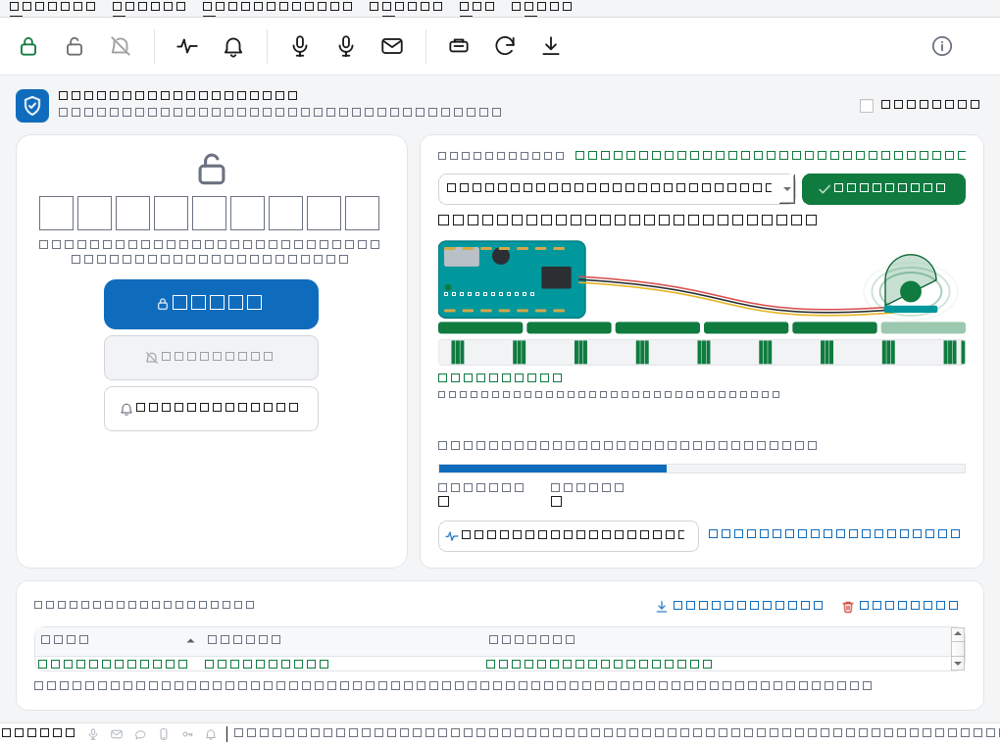
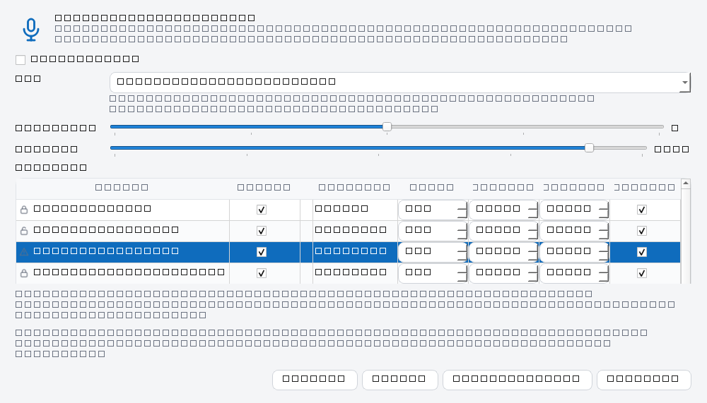
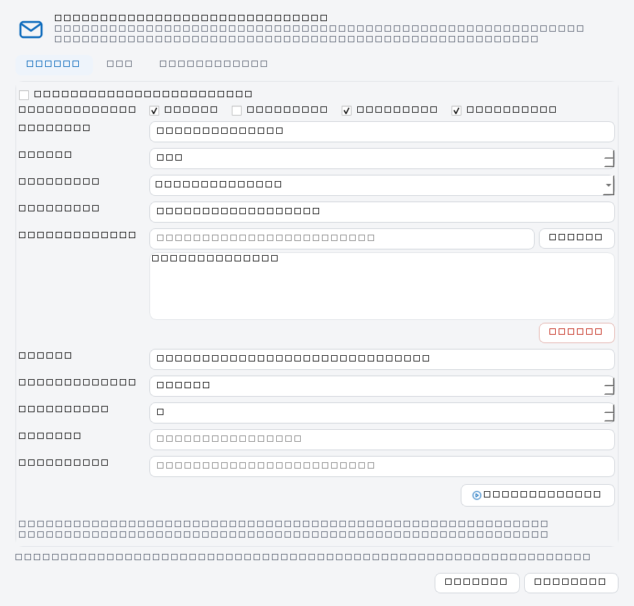
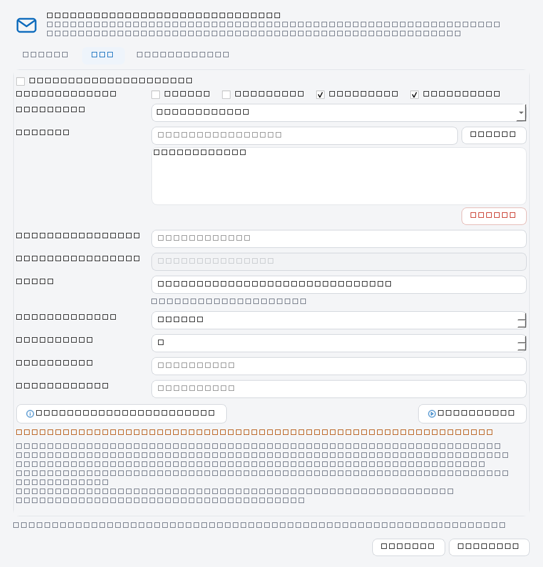
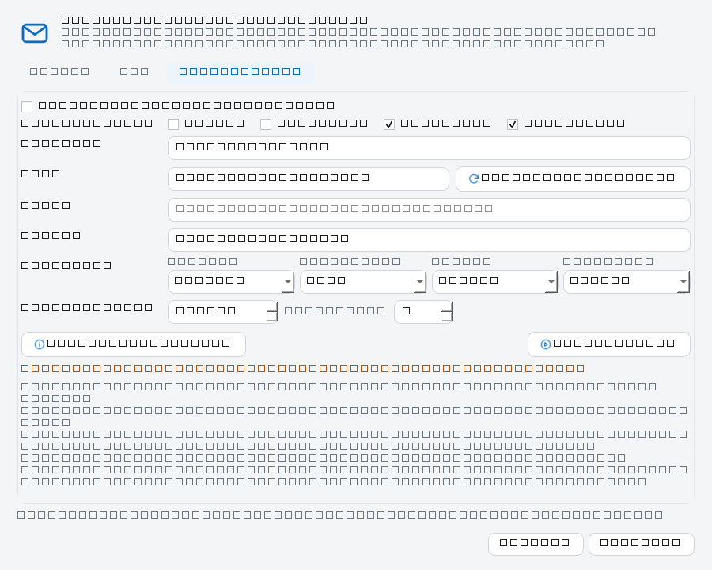
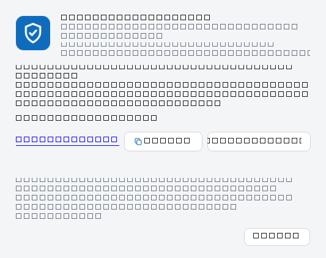
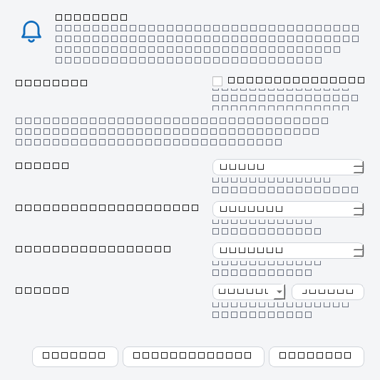
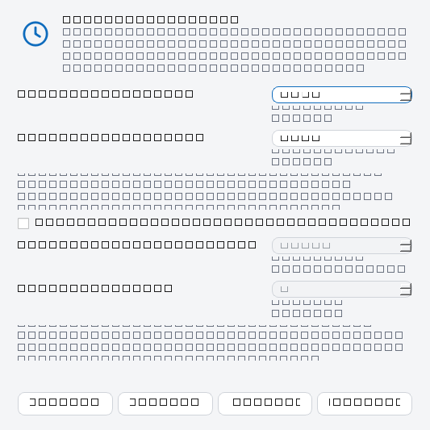
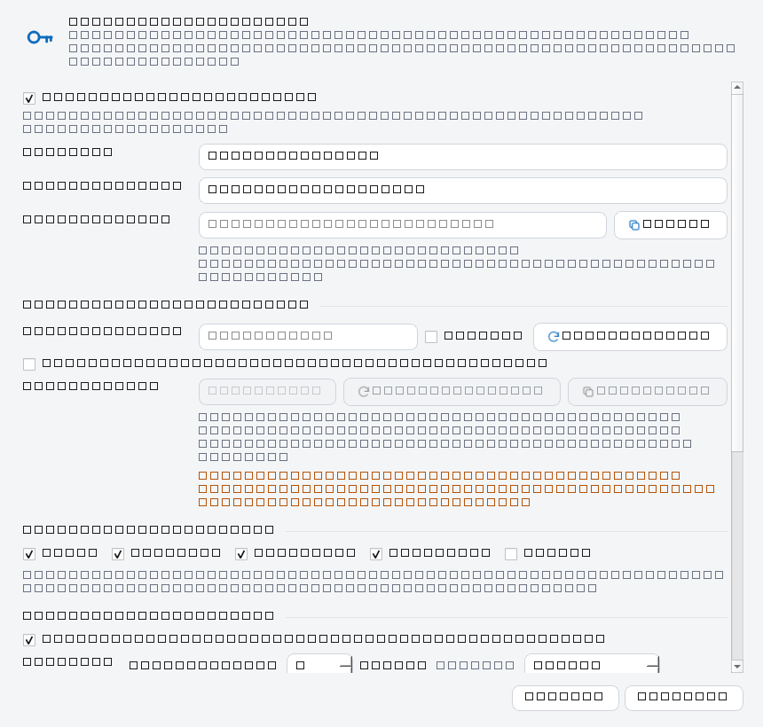

# Interfaz: ventana principal, diálogos y atajos

Referencia de la interfaz PyQt6 que sustituye a la ventana tkinter de F1.2. La
idea de fondo es que **lo de todos los días esté en la pantalla** y lo de una vez
al mes, en un diálogo. Armar y desarmar se hace con un clic; el resto (textos de
voz, credenciales, ajuste del sensor) no compite por espacio.

---

## 1. Aspecto general



La ventana mide 1020×760 por defecto y no baja de 880×750 (por debajo, Qt
reparte menos altura de la que piden las filas). Se divide en cuatro zonas:

| Zona | Qué contiene |
|---|---|
| Cabecera | Icono, nombre y subtítulo, y casilla **Simulado** |
| Hero | Icono grande del estado, etiqueta configurable, pista de qué hacer y botón principal |
| Tarjeta de dispositivo | Estado del enlace, puerto, conectar, panel del sensor, calentamiento, contadores y ajuste |
| Registro | Cronología con color e icono por tipo de evento, con ordenación y exportación |

La barra de herramientas repite las acciones frecuentes y la barra de estado
muestra el último mensaje, seis indicadores de canal (voz, correo, SMS, móvil,
mando remoto y zumbador, en azul, gris o ámbar), los ficheros de configuración
cargados y la versión del protocolo. Ver §2.2.

### 1.0 La ventana se adapta, no recorta

Al estrecharse, la ventana reduce tamaños antes que cortar texto:

- **El hero manda en el ancho**: no baja de 400 px. Si no hay sitio, cede la
  tarjeta de dispositivo, que se queda con lo que sobre.
- **El rótulo del estado y el reloj** bajan de cuerpo hasta que el texto cabe en
  la tarjeta (`30 → 13 pt` y `46 → 20 pt`, como mucho el máximo de la hoja de
  estilos: nunca crecen por encima). Con la ventana en su mínimo, «DESARMADA»
  se lee a 29 pt en lugar de salirse por los lados.
- **Las acciones del hero pasan a columna** cuando en una fila se recortarían
  sus etiquetas. En columna se recortan también la holgura, el icono de estado
  (`64 → 44 px`), el reloj (máximo 32 pt) y el alto de los botones (`58 → 46
  px`), para que el hero siga cabiendo con la cuenta atrás en marcha.
- **La barra de herramientas no esconde acciones.** Qt, cuando no cabe, deja el
  resto en un menú «»» que en la práctica no se ve; aquí se prueba primero
  icono + texto con iconos de 26 px y, si no cabe, se quedan solo los iconos
  (de 26 a 16 px). Las etiquetas siguen en la descripción emergente y en los
  menús. A 1020 px la barra va en iconos; el texto vuelve a partir de ~3000 px.

Las decisiones se miden con el ancho disponible en cada momento, no con un
tamaño fijo, así que la interfaz se recoloca sola al redimensionar la ventana.


### 1.1 El hero

El hero responde a «¿está puesta la alarma?» sin leer nada más:

| Estado | Color | Qué muestra |
|---|---|---|
| `DESARMADA` | Gris | Escudo abierto y «no avisará de movimiento» |
| `ARMANDO` | Ámbar | Cuenta atrás del retardo de salida y «sal de casa» |
| `ARMADA` | Verde | Escudo cerrado y «vigilando» |
| `ENTRADA` | Ámbar | Cuenta atrás del retardo de entrada y aviso de desarmar |
| `DISPARADA` | Rojo | Campana y recordatorio de silenciar o desarmar |
| `REARMANDO` | Ámbar | Cuenta atrás hasta volver a vigilar sola tras un disparo |
| Silenciada | Ámbar | Campana tachada y «sigue armada y vigilando» |

En `ARMANDO`, `ENTRADA` y `REARMANDO` el hero añade un **reloj grande** con el
tiempo que queda en formato `MM:SS` (`00:45`), debajo la etiqueta de estado y
encima de la pista. Se actualiza cuatro veces por segundo sin tocar icono ni
color. Debajo del número hay una barra fina que mide el **margen restante**:
empieza llena y se vacía con el plazo, de modo que de un vistazo se ve cuánto
queda aunque no se lea la cifra. Ambos se ocultan en cuanto no hay retardo en
curso, así que no ocupan sitio en el uso normal.

El número se redondea hacia arriba: con 0,4 s restantes aún se lee `00:01`, que
es más honesto que mostrar `00:00` mientras el zumbador sigue pitando. La
duración total para calcular la barra la guarda el controlador al abrir el
retardo, no la configuración: cambiar los retardos con la cuenta atrás en marcha
no descuadra el reloj (el plazo en curso no se recorta a mitad).

El texto grande sale de `[ui.labels]` (o de la etiqueta del evento de voz), así
que se puede decir «EN GUARDIA» en lugar de «ARMADA» sin tocar código.

El botón principal cambia de texto y de color con el estado: azul para **Armar**,
rojo para **Desarmar**. **Silenciar** solo se habilita cuando hay una alarma
activa; un botón deshabilitado explica mejor el estado que un error al pulsarlo.

### 1.2 La tarjeta de dispositivo

La cabecera de la tarjeta lleva una línea de estado del enlace, que es la única
que informa de la conexión (antes había además un chip «Conectado» en la
cabecera de la ventana que repetía el mismo dato):

| Línea | Cuándo |
|---|---|
| ● Conectado · latido hace 0,4 s | Hay enlace y la placa late |
| ● Reconectando · próximo intento en 3 s | El lector insiste solo |
| ● Sin enlace | No hay dispositivo o el usuario lo ha desconectado |

- **Puerto**: desplegable con los puertos serie detectados. La placa se
  preselecciona por VID/PID cuando se puede. Sin enlace, la lista se refresca
  cada 3 s: enchufar la placa después de arrancar ya no obliga a reiniciar.
- **Botón de conexión**: no es un botón cualquiera, es un indicador con acción.
  Tiene tres estados y el color dice cuál es:

| Estado | Aspecto | Qué significa |
|---|---|---|
| `connected` | Verde, check, **Conectado** (deshabilitado) | El enlace está vivo; no hay nada que pulsar |
| `retrying` | Ámbar, **Reconectando…** (deshabilitado) | El lector insiste solo; el tooltip dice en cuántos segundos |
| `offline` | Gris, **Conectar** (habilitado) | No hay enlace que mantener |

  Arrancar sin la placa deja el botón en ámbar **Reconectando…**, no en gris:
  el lector está intentándolo. Esa primera espera no genera aviso ni etiqueta
  roja, porque no se ha perdido nada; solo cuenta como caída lo que ocurre
  después de haber recibido datos de la placa.

  Al conectar, `DeviceManager` reintenta con retroceso exponencial hasta
  `serial.reconnect_max_s`. Si la placa reaparece en otro `COMx`, `SerialLink`
  la vuelve a detectar por VID/PID: no se queda atascado en el puerto viejo.
  Un hilo de lectura que muera se relanza desde el refresco de la ventana.
- **Aviso «Sin sensor»**: si se pierde el enlace después de haber estado
  conectado, aparece una etiqueta roja en la tarjeta y la pista del hero añade
  «Sin sensor: la alarma no está disponible». Se registra, se dice por voz y,
  si está configurado, se avisa por correo, SMS y móvil (ver
  [`03-AVISOS.md`](03-AVISOS.md) §8).
- **Panel del sensor**: sustituye a la antigua lámpara. Es una ilustración de la
  placa (verde azulado, con USB, chip, cabeceras doradas y serigrafía *ARDUINO
  MEGA*) unida por tres cables a la cúpula del HC-SR501. Muestra, en vivo y con
  la alarma armada o no:
  - un **LED que destella con cada latido**, prueba visual de que el enlace
    sigue vivo cada dos segundos;
  - **ondas** alrededor de la cúpula mientras dura una detección;
  - **seis barras de actividad** que suben al detectar y bajan en unos 2,5 s,
    para que un pulso de 2,7 s se vea aunque dure poco;
  - una **franja de 60 s** (una celda por cada medio segundo) con el histórico
    de movimiento: lo que el usuario pedía ver «todo el tiempo que está
    funcionando»;
  - el texto **Reposo** / **MOVIMIENTO**, «última hace N s» y el porcentaje de
    actividad de los últimos 10 s.

  El HC-SR501 es **digital**: solo distingue movimiento y reposo. No se dibuja
  distancia ni nivel analógico porque no existen; las barras y la franja
  representan actividad reciente, no una medida inventada. Sin enlace el panel
  se apaga y se detiene su animación para no gastar CPU.
- **Calentamiento**: el HC-SR501 tarda hasta un minuto en dar lecturas fiables.
  Bajo la etiqueta hay una barra con la cuenta atrás en segundos, que avanza con
  los latidos (`up_ms`) y desaparece en cuanto la placa anuncia `Ready`. El
  enlace **Omitir calentamiento** acorta la espera. El estado de partida lo da
  `warmup_ms` en el mensaje `Hello`; si la placa arranca con `warmup_ms = 0` la
  barra ni se muestra.
- **Contadores**: eventos de movimiento y pulsos completos.
- **Ajuste del sensor…**: abre el asistente de calibración.

### 1.3 El registro

Cada fila lleva hora, icono, tipo y detalle, con color por tipo:

| Tipo | Color |
|---|---|
| Movimiento (`start`) | Verde |
| Fin de pulso (`end`) | Gris |
| Rebote (`bounce`) | Ámbar |
| Error (`error`) | Rojo |
| Disparo (`triggered`) | Rojo, en negrita, con el tiempo de sirena y el rearme previsto |
| Sirena terminada (`rearming`) | Ámbar |
| Rearmada tras disparo (`rearmed`) | Ámbar, en negrita, con el número de rearme |
| Informativo (`info`, `alarm`) | Azul |
| Latido (`heartbeat`) | Gris claro |

Los latidos solo se muestran si se marcan en **Ver → Mostrar latidos**: en uso
normal son ruido.

El registro que se ve es una **vista**: el historial completo vive en SQLite
(`data/alarm.db`) y se conserva entre arranques. El árbol muestra las últimas
`[log].visible_rows` filas (1.000 por defecto) para que la ventana no se
arrastre, y el pie lo resume:

> Mostrando las últimas 1.000 de 12.480 · retención 1 año / 100.000 eventos

La retención tiene dos límites que se aplican a la vez: se borra lo que tenga
más de `max_age_days` días **y** lo que exceda `max_events` filas. Se comprueba
al arrancar y cada 500 inserciones, así que la base no crece sin freno. Ojo: el
segundo límite puede recortar antes que el primero si algo genera eventos en
bucle; «un año» es el techo, no una garantía.

**Exportar CSV** (cabecera de la tarjeta, **Archivo → Exportar registro…** o
`Ctrl+E`) vuelca **todo** el historial, no solo lo visible, a un CSV con
`fecha_local, fecha_utc, severidad, evento, detalle`. Se guarda en UTF-8 con
BOM para que Excel muestre bien los acentos, y el módulo `csv` escapa comas,
comillas y saltos de línea. El nombre por defecto es
`data/registro-alarma-AAAAMMDD-HHMM.csv`.

**Consultar desde la terminal.** Para buscar sin abrir la ventana existe
`alarmctl log`, que lee la misma base en modo **solo lectura** (funciona con la
ventana abierta y nunca crea una base vacía si la ruta está mal):

```powershell
# Ultimos 30 eventos (por defecto)
.\.venv\Scripts\python.exe tools\alarmctl.py log

# Que paso las ultimas 24 h, solo los disparos
.\.venv\Scripts\python.exe tools\alarmctl.py log --since -24h --tag triggered

# Un rango concreto y solo lo que diga «Enlace» en el tipo
.\.venv\Scripts\python.exe tools\alarmctl.py log --since 2026-11-01 --until "2026-11-12 23:59" --kind Enlace

# Cuantos hay, sin listarlos, y que etiquetas existen
.\.venv\Scripts\python.exe tools\alarmctl.py log --count
.\.venv\Scripts\python.exe tools\alarmctl.py log --tags

# Exportar a CSV lo que cumpla los filtros (aqui, los disparos del ultimo mes)
.\.venv\Scripts\python.exe tools\alarmctl.py log --since -30d --tag triggered --csv data\disparos.csv
```

| Opción | Qué hace |
|---|---|
| `--limit N` | Filas a mostrar, las más recientes (`0` = todas; por defecto 30) |
| `--since`, `--until` | Rango: `2026-11-12`, `2026-11-12 18:30`, `12/11/2026` o relativo `-24h`, `-90m`, `-7d` |
| `--tag` | Etiqueta exacta (`triggered`, `error`, `rearmed`, `info`…) |
| `--kind` | Texto contenido en el tipo de evento, sin distinguir mayúsculas |
| `--text` | Texto contenido en el detalle |
| `--count` | Solo cuenta las filas |
| `--csv RUTA` | Exporta a CSV todo lo que cumpla los filtros (ignora `--limit`) |
| `--tags` | Lista las etiquetas guardadas y cuántas filas tiene cada una |
| `--db RUTA` | Consulta otro historial en vez de `[log].db_path` |

La ruta de la base se resuelve contra la **raíz de datos**, no contra el
directorio desde el que se lance el comando: la del repositorio en desarrollo, la
carpeta del `.exe` cuando la aplicación va empaquetada (o `%LOCALAPPDATA%\AlarmaCasa`
si esa carpeta no admite escritura). Así `alarmctl` y la ventana miran el mismo
historial aunque se abran desde carpetas distintas.

**Guardar configuración en JSON** (**Archivo → Guardar configuración en JSON…**
o `Ctrl+Mayús+C`) escribe un volcado de *toda* la configuración vigente: serial,
alarma, voz, correo, SMS, ntfy, interfaz, zumbador y registro. Se recorre
`AppConfig` campo a campo, así que una sección nueva aparece sola; el nombre por
defecto es `data/config-alarma-AAAAMMDD-HHMM.json` y el resultado se ve en la
barra de estado. No es un fichero de restauración: sirve para revisar cómo está
montado el sistema o adjuntarlo a un informe.

Las credenciales no salen: `email.user`, `email.password`, `sms.token` y
`ntfy.token` quedan en `""` y se listan en `credenciales_omitidas`. Los
destinatarios, el remitente, el SID de Twilio, los números y el servidor y tema
de ntfy sí se conservan, que es lo que hace falta para entender por qué no llega
un aviso. La escritura es atómica: si falla a medias no queda un JSON truncado.

**Guardar copia completa (con credenciales)…** (**Archivo → Guardar copia
completa…**, `Ctrl+Mayús+B`) es el otro extremo: un solo fichero
`copia-alarma-AAAAMMDD-HHMM.alarmbackup` con todo lo necesario para montar la
alarma en otro PC. Antes de abrir el diálogo de guardado avisa de lo que va
dentro, porque el fichero **lleva la contraseña SMTP, el token de Twilio y el
de ntfy en claro**: es JSON legible, sin cifrar, para que una copia se pueda
abrir y revisar con el Bloc de notas si algo falla. Se escribe con permisos de
solo el usuario y el mensaje de la barra de estado recuerda que contiene
credenciales.

El contenido es la configuración **completa**, incluidas las secciones sin
diálogo (`serial` y `log`), más un bloque `secretos` con las claves de `.env`
que tengan valor. Lo que no esté configurado no se inventa: una copia de un PC
sin SMS no lleva token vacío. El historial de eventos **no** viaja aquí; para
eso está *Exportar registro…*.

**Restaurar copia completa…** (**Archivo → Restaurar copia completa…**,
`Ctrl+Mayús+R`) lee el fichero, enseña antes de escribir nada de dónde viene
(fecha, versión, equipo, secciones y cuántas credenciales trae) y pide
confirmación con *No* por defecto. Al aceptar:

- escribe la capa `config/alarm.local.toml` (nunca toca `alarm.toml`, el fichero
  base con comentarios);
- actualiza en `.env` solo las claves que vienen en la copia: las que no están
  se quedan como estaban, con sus comentarios y el resto de líneas;
- recarga la configuración en caliente, sin reiniciar. Si la copia trae otro
  puerto serie o baudios, el aviso final recuerda que hay que reconectar.

Un fichero que no sea una copia (JSON suelto, copia de otra versión más nueva o
con valores imposibles) se rechaza **antes** de escribir: la validación pasa por
el mismo `from_mapping` que la carga normal, así que una copia mala no deja la
aplicación sin arrancar.

**Pulsa una cabecera para ordenar** por hora, evento o detalle, en cualquiera de
los dos sentidos. La hora se ordena por instante real, no por el texto
`HH:MM:SS`, así que cruzar la medianoche no descoloca las filas; dos eventos en
el mismo milisegundo mantienen su orden. El recorte por `visible_rows` sigue el
orden de llegada, de modo que ordenar por detalle no borra la fila equivocada.
Al volver a la hora ascendente, el registro se desplaza solo al último evento.

**Limpiar…** (junto a *Exportar CSV*, **Herramientas → Limpiar registro…** o
**Ctrl+L**) vacía el árbol, la base y los contadores **después de confirmarlo**:
el aviso dice cuántos eventos se van a borrar y responde *No* por defecto,
porque la operación no se puede deshacer.

---

## 2. Menús

| Menú | Opciones |
|---|---|
| **Archivo** | Conectar (`Ctrl+R`), Desconectar, Exportar registro… (`Ctrl+E`), Guardar configuración en JSON… (`Ctrl+Mayús+C`), Guardar copia completa… (`Ctrl+Mayús+B`), Restaurar copia completa… (`Ctrl+Mayús+R`), Salir (`Alt+F4`) |
| **Alarma** | Armar (`Ctrl+Mayús+A`), Desarmar (`Ctrl+D`), Silenciar (`Ctrl+Mayús+M`), Probar zumbador, Zumbador… (`Ctrl+Alt+B`), Retardos y rearme… (`Ctrl+Alt+R`) |
| **Herramientas** | Configuración de voces… (`Ctrl+Alt+V`), Zumbador… (`Ctrl+Alt+B`), Ajuste del sensor… (`Ctrl+A`), Omitir calentamiento del PIR, Exportar registro… (`Ctrl+E`), Guardar configuración en JSON… (`Ctrl+Mayús+C`), Guardar copia completa… (`Ctrl+Mayús+B`), Restaurar copia completa… (`Ctrl+Mayús+R`), Limpiar registro… (`Ctrl+L`) |
| **Avisos** | Configuración de voces…, Correo, SMS y móvil…, Mando remoto (ntfy)…, Voz por el altavoz, Aviso por correo, Aviso por SMS, Aviso al móvil (ntfy), Probar voz, Recargar configuración |
| **Ver** | Mostrar latidos, Pitidos al ajustar |
| **Ayuda** | Acerca de… (`F1`), Contacto… |

Las casillas **Voz por el altavoz**, **Aviso por correo**, **Aviso por SMS** y
**Aviso al móvil (ntfy)** silencian un canal entero sin borrar su configuración.
Al guardar desde un diálogo, las casillas se sincronizan sin volver a disparar
la acción.

**Desactivar un canal pide confirmación**: apagar un aviso no avisa de nada y el
fallo se descubre el día que la alarma suena y nadie se entera. El aviso nombra
lo que se pierde y lo que no cambia (el resto de canales y el zumbador siguen
igual), y la respuesta por defecto es *No*. Si se cancela, la casilla vuelve a
su sitio y la barra de estado dice «La voz sigue activada.». Activar un canal no
pregunta nada.

Esas casillas, y las de **Ver → Mostrar latidos** y **Pitidos al ajustar**, se
escriben en `config/alarm.local.toml` en cuanto se marcan. Así sobreviven a
**Avisos → Recargar configuración** y a cerrar la aplicación; antes solo
cambiaban en memoria y volvían a su valor del fichero. Si el TOML no se puede
escribir, la casilla vuelve a su sitio y se avisa, para que el menú no diga algo
distinto de lo guardado.

### 2.1 Atajos

| Atajo | Acción |
|---|---|
| `Ctrl+Mayús+A` | Armar |
| `Ctrl+D` | Desarmar |
| `Ctrl+Mayús+M` | Silenciar |
| `Ctrl+Alt+V` | Configuración de voces |
| `Ctrl+Alt+B` | Zumbador: prueba y ajuste |
| `Ctrl+Alt+R` | Retardos y rearme |
| `Ctrl+R` | Conectar o reconectar |
| `Ctrl+A` | Ajuste del sensor |
| `Ctrl+E` | Exportar todo el historial a CSV |
| `Ctrl+Mayús+C` | Guardar la configuración en JSON |
| `Ctrl+Mayús+B` | Guardar copia completa (con credenciales) |
| `Ctrl+Mayús+R` | Restaurar copia completa |
| `Ctrl+L` | Limpiar registro |
| `F1` | Acerca de |
| `Alt+F4` | Salir |

Los atajos son de aplicación (`ApplicationShortcut`): funcionan aunque el foco
esté en el registro o en la tarjeta del dispositivo.

### 2.2 La barra de estado

De izquierda a derecha: el último mensaje de la aplicación, seis indicadores
de canal, y a la derecha la fuente de configuración y la versión del protocolo.

| Indicador | Icono | Se enciende con | Dónde se cambia |
|---|---|---|---|
| Voz | Micrófono | `tts.enabled` | Avisos → Voz por el altavoz |
| Correo | Sobre | `email.enabled` | Avisos → Aviso por correo |
| SMS | Bocadillo | `sms.enabled` | Avisos → Aviso por SMS |
| Móvil | Teléfono | `ntfy.enabled` | Avisos → Aviso al móvil (ntfy) |
| Mando | Llave | `remote.enabled` y `remote_missing()` vacío | Avisos → Mando remoto (ntfy)… |
| Zumbador | Campana | `buzzer.enabled` | Alarma → Zumbador… |

Tres estados, que se distinguen de un vistazo:

- **Azul**: el canal está activo y puede avisar.
- **Gris**: está apagado a propósito.
- **Ámbar**: está activo pero le faltan datos (correo sin credenciales, SMS sin
  cuenta de Twilio, ntfy sin tema). Encendido y mudo es peor que apagado,
  porque el menú dice que sí.

El indicador del **mando** tiene un matiz propio: en ámbar también cuando está
activo, completo y el listener ha perdido la conexión; el tooltip añade el
último error. En gris, apagado; en azul, escuchando de verdad.

Son solo indicadores: un clic no cambia nada, y el tooltip dice el estado y
dónde se enciende. Se repintan solos al marcar una casilla, al guardar desde un
diálogo y al recargar la configuración, así que no muestran una foto vieja.

---

## 3. Diálogos

Todos los diálogos comparten la misma estructura: cabecera con icono y
explicación, cuerpo con formulario, botones **Cancelar** y **Guardar**, y
botones de acción a la izquierda (**Probar**, **Restaurar**). Ninguno bloquea el
hilo de la interfaz mientras habla o envía.

### 3.1 Configuración de voces



Una sola ventana para todo lo que se dice y cómo se dice. Se abre desde
**Herramientas → Configuración de voces…**, desde **Avisos** (misma entrada) o
con `Ctrl+Alt+V`. Sustituye a los antiguos diálogos por evento y de ajustes: con
seis avisos, comparar retardos exigía abrir seis ventanas.

**Bloque de voz del sistema** (común a todos los mensajes):

| Campo | Rango | Para qué |
|---|---|---|
| Voz activada | — | Desactiva todos los mensajes hablados de una vez |
| Voz | Lista SAPI o texto | Voz instalada; se consulta una sola vez por sesión |
| Velocidad | −10 a +10 | 0 es lo normal |
| Volumen | 0–100 % | Volumen del sintetizador, no del mezclador |

Si la consulta de voces falla, el desplegable queda vacío pero sigue siendo
editable y la ventana abre igual.

**Tabla de mensajes** (una fila por aviso):

| Columna | Qué configura |
|---|---|
| Evento | Armada, desarmada, disparada, sensor perdido y sensor listo (solo lectura) |
| Activo | Si ese aviso se pronuncia o no |
| Mensaje | Frase hablada; admite `{hora}`, `{evento}`, `{zona}` y `{duracion}` |
| Etiqueta | Texto del hero; solo aplica a armada, desarmada y disparada |
| Repes | 0–10 repeticiones; 0 equivale a no decirlo |
| Retardo | 0–120 s de espera **antes de la primera** palabra |
| Intervalo | 0–30 s de pausa **entre** repeticiones |
| Registrar | Si la locución deja una fila «Voz» en el registro |

Las celdas de texto se editan con doble clic; las casillas y los números,
directamente. Debajo de la tabla, la **vista previa** de la fila seleccionada
resuelve la plantilla con la hora actual y resume cómo quedará:

> Se dirá: «Atención. Se ha detectado una presencia a las 21:14.»
> 2 repeticiones cada 1,5 s · empieza a los 0,0 s · queda en el registro

| Botón | Qué hace |
|---|---|
| **Probar** | Pronuncia la fila seleccionada con los valores de la tabla, sin guardar |
| **Restaurar todo** | Devuelve la tabla y la voz a los valores de fábrica |
| **Guardar** | Valida y escribe en `config/alarm.local.toml` |
| **Cancelar** | Cierra sin tocar nada |

**Guardar** rechaza los avisos activos con texto vacío y enumera cuáles son. La
columna **Registrar** no afecta al evento en sí: una caída del enlace apunta
siempre «Sin sensor», pero si se desmarca, la frase hablada no se repite en el
historial.

### 3.2 Correo, SMS y móvil



Tres pestañas con la misma estructura: activar el canal, marcar qué eventos
avisan (armada, desarmada, disparada, **sin sensor**), destinatarios y
credenciales. La casilla **Sin sensor** genera el aviso de `device_lost` por ese
canal cuando se pierde el enlace con la placa.

**Pestaña Correo**
- Servidor, puerto y seguridad (`STARTTLS`, `SSL`, sin cifrar).
- Remitente y lista de destinatarios con añadir/quitar y validación.
- Asunto (admite `{evento}` y `{hora}`), timeout y reintentos.
- Usuario y contraseña. La contraseña aparece **vacía con el texto «sin
  cambios»**: si no se toca, no se reescribe en `.env`.
- **Probar correo** envía un mensaje real con la configuración en pantalla.

**Pestaña SMS**



- Proveedor: **Twilio** o **Pasarela correo → SMS**. Al cambiar, se habilitan
  solo los campos que aplican.
- Lista de números; se normalizan a `+34…` al guardar. Un número tecleado y no
  añadido cuenta igualmente: probar o guardar lo incorpora.
- Remitente Twilio o dominio de la pasarela, según el proveedor. El remitente
  también se normaliza.
- Texto con **contador de caracteres** y aviso de recorte a 160.
- SID y token de Twilio (vacío = sin cambios, se guardan en `.env`).
- **Estado en vivo** bajo los botones: «Listo para probar» o la lista exacta de
  lo que falta («Falta: cuenta SID, token de autenticación y número remitente»).
- **Abrir consola de Twilio** lleva a `console.twilio.com`, donde están el
  Account SID, el Auth Token y los números.
- **Probar SMS** valida antes de enviar: si falta algo, explica qué campo es en
  lugar de fallar con un error del proveedor.

La guía de la propia pestaña resume lo que hay que tener: cuenta de Twilio, sus
dos credenciales, un número remitente comprado o verificado, el coste por SMS a
España y la limitación de la cuenta de prueba a números verificados.

**Pestaña Móvil (ntfy)**



- **Enviar avisos al móvil (ntfy)**: activa el canal.
- Servidor (`https://ntfy.sh` por defecto) y **tema**. El botón **Generar tema
  seguro** rellena un nombre largo y aleatorio (`alarma-…`): en el servidor
  público el tema es lo único que separa tus avisos de los demás.
- **Título** de la notificación, con `{evento}` sustituido por `DISPARADA`,
  `armada`, `desarmada` o `sin sensor`.
- Una **prioridad por evento** (`min`, `low`, `default`, `high`, `urgent`).
  `urgent` hace sonar el móvil aunque esté en silencio: por defecto, solo el
  disparo.
- Timeout y reintentos.
- **Token** del servidor propio. Vacío = sin cambios; se guarda en `.env`.
- **Estado en vivo**: «Falta: tema», o un aviso en ámbar si el tema es corto en
  `ntfy.sh`, si la conexión va por `http` o si el tema queda público.
- **Probar móvil** valida antes de enviar y explica qué falta si no se puede.
- **Abrir guía de ntfy** lleva a `docs.ntfy.sh`, con la instalación de la app y
  la suscripción al tema.

La guía de la pestaña son los cuatro pasos reales: instalar la app, generar el
tema, suscribirse en el móvil y probar.

**Guardado transaccional**: se valida todo antes de escribir. Si falta el
servidor, un destinatario, el token o el tema, no se guarda nada y la pestaña
culpable pasa a primer plano con el motivo concreto.

### 3.3 Resultado de una prueba

Modal pequeño con el resultado (correcto o fallido), el motivo saneado y un
botón **Reintentar**. Se abre cuando termina la prueba, que corre en su propio
hilo; la ventana sigue respondiendo mientras espera.

### 3.4 Acerca de / Contacto



Muestra nombre, versión, protocolo, hardware, si se está en modo simulado y
**de dónde sale el programa**: «Código fuente · datos en …» cuando se ejecuta
desde el repositorio, o «Ejecutable portátil · datos junto al .exe» cuando corre
empaquetado. Si el `.exe` está en una carpeta protegida, dice también la ruta de
`%LOCALAPPDATA%` donde han ido a parar los datos. Es la primera pregunta cuando
alguien no encuentra su configuración.
Incluye el correo de contacto **josealberto.vel@gmail.com** con:

- enlace `mailto:` que abre el cliente de correo;
- botón **Copiar** que lo deja en el portapapeles y confirma con un mensaje.

### 3.5 Ajuste del sensor

El asistente de F1.1, portado a `QDialog`. Conserva las dos fases (reposo y
movimiento), la cuenta atrás, la barra de actividad en vivo y el veredicto con
los cuatro hallazgos. Añade **Pitidos al ajustar** para guiar sin mirar la
pantalla y no bloquea la recepción de eventos.

Las tres duraciones se fijan al pulsar **Comenzar** y viajan con el asistente,
no se releen de los controles al acabar la cuenta atrás: al cambiar de paso la
introducción se destruye, y leerlos más tarde abortaba la aplicación. **Repetir**
recupera los últimos valores elegidos en vez de volver a los de fábrica.

Si aun así algo falla dentro de la interfaz, la aplicación ya no se cierra:
registra la traza y lo avisa en la barra de estado (ver §5).

### 3.6 Zumbador



Se abre con **Alarma → Zumbador…**, **Herramientas → Zumbador…** o `Ctrl+Alt+B`.
Es la única pieza del montaje que se comprueba con el oído, así que la ventana
junta prueba y ajuste:

| Campo | Rango | Para qué |
|---|---|---|
| Zumbador | casilla | Interruptor del zumbador en la placa (`buzzer`); no afecta a voz ni avisos remotos |
| Frecuencia de prueba | 100–8000 Hz | Resonancia del piezo; se busca a oído dónde suena más fuerte |
| Duración del tono | 100–10000 ms | Cuánto suena el tono continuo |
| Patrón | 6 patrones | Mismo pitido que hará la placa en cada situación |
| Sirena | 1–600 s | Duración del patrón `alarm` al dispararse (2 min por defecto) |

Botones de la izquierda: **Tono continuo** y, junto al desplegable de patrón,
**Reproducir**. Las pruebas se envían con `force=1`, así que suenan aunque el
PIR esté calentando —antes el firmware callaba y el silencio parecía un cableado
mal puesto—. Si la casilla se acaba de marcar y aún no se ha guardado, antes del
pitido se adelanta `set buzzer=1` a la placa.

Sin conexión, los controles de prueba quedan deshabilitados y la ventana lo dice.
El texto de cableado recuerda la polaridad (pata larga al pin) y que un piezo
pasivo suele sonar también del revés.

### 3.7 Retardos y rearme



Se abre con **Alarma → Retardos y rearme…** o `Ctrl+Alt+R`.

| Campo | Rango | Para qué |
|---|---|---|
| Retardo de salida | 0–300 s (`Sin retardo`) | Tiempo para salir antes de que el PIR vigile |
| Retardo de entrada | 0–300 s (`Sin retardo`) | Tiempo para desarmar desde que detecta |
| Rearmar automáticamente | casilla | Vuelve a armarse sola al terminar la sirena |
| Espera antes de rearmar | 1–120 min | Silencio entre el fin de la sirena y el rearme |
| Rearmes máximos | 1–10 | Tope de rearmes seguidos antes de quedarse disparada |

`0` desactiva los retardos: la alarma vigila o dispara al instante, como antes
de esta función. Los valores por defecto son 45 s y 30 s. El rearme viene
desactivado, con 5 minutos de espera y 3 intentos.

Mientras dura la espera el hero muestra `REARMANDO` en ámbar con el mismo reloj
grande `MM:SS` de los retardos. Al vencer queda `ARMADA` directamente, sin
retardo de salida, porque quien provocó el disparo ya está dentro. Si se agotan
los rearmes, la alarma se queda `DISPARADA` hasta que se desarme a mano.

**Escuchar salida** y **Escuchar entrada** mandan a la placa 8 segundos de la
cadencia real —pitidos que se aceleran, más agudos los de entrada— sin armar
nada. Si el zumbador está apagado o no hay enlace, la ventana lo explica.

La nota inferior advierte de la consecuencia de tener un solo PIR: todo el
movimiento pasa por el retardo de entrada, así que quien entre también tendrá
ese margen. Es el comportamiento de una zona «de entrada» en una central
profesional, sin las zonas interiores que dispararían al instante.

### 3.8 Mando remoto por ntfy



Se abre con **Avisos → Mando remoto (ntfy)…**. La mitad de arriba configura el
canal; la de abajo enseña lo que está pasando ahora mismo.

| Campo | Para qué |
|---|---|
| Aceptar órdenes por ntfy | Arranca y para la escucha. Sin el canal móvil activo no se puede marcar |
| Servidor y tema de avisos | Solo lectura: son los del canal móvil |
| Tema de mando | Vacío usa `<tema de avisos>-mando`; botón **Copiar** del valor efectivo |
| Clave de mando | Contraseña, «sin cambios» si ya existe, **Mostrar** y **Generar clave** (mínimo 12) |
| Usar TOTP | Secreto en contraseña, **Generar secreto** y **Copiar URI** `otpauth://` |
| Órdenes que se aceptan | Armar, Desarmar, Consultar, Silenciar y **Pánico** (desactivado) |
| Responder al móvil | Contesta cada orden en el tema de avisos con `[Mando]` |
| Bloquear tras N fallos, durante M minutos | Bloqueo por fuerza bruta; 0 intentos lo desactiva |

El panel **Estado en vivo** se refresca cada segundo con la foto del listener:
«Escuchando «alarma-xxx-mando» desde las 08:12:01. Recibidas 4, aceptadas 3,
rechazadas 1», o «Sin conexión… se reintenta solo» con el último error. Debajo,
la última orden con su hora y resultado y una tabla con las 20 últimas de la
sesión (hora, orden, resultado, en verde o rojo). Lo que sobrevive es la fila del
historial, no la tabla.

Los avisos que pueden aparecer bajo los campos son deliberados: si el canal
móvil está apagado o incompleto no se puede escuchar; si se usa clave sin TOTP
en `ntfy.sh`, en ámbar, que quien lea el tema verá la clave. El botón **Enviar
estado al móvil** es la prueba del canal: publica ahora mismo la misma respuesta
que daría `consultar`.

Al guardar, el diálogo escribe la tabla `[remote]` en `alarm.local.toml` y la
clave o el secreto en `.env`. Si cambia el tema, la clave, el TOTP o el bloqueo,
el listener se reinicia sin cerrar la ventana; apagar la casilla lo detiene.

---

## 4. Configuración desde la interfaz

Los diálogos **no** reescriben `config/alarm.toml`. Guardan solo lo cambiado en
`config/alarm.local.toml`, que se aplica encima al cargar. Los secretos van a
`.env` con escritura atómica. Ver [`00-PREMISAS.md`](00-PREMISAS.md) ADR-018 y
[`03-AVISOS.md`](03-AVISOS.md) §2.

Al guardar, la ventana aplica los cambios **en caliente**: reconfigure de voz,
correo, SMS y móvil, límites de aviso nuevos y repintado del hero. No hace falta
reiniciar. **Avisos → Recargar configuración** vuelve a leer ambos TOML si los
editaste a mano.

---

## 5. Notas técnicas

- **Hilos**: `DeviceManager` lee el puerto en su hilo y publica por
  `QtBridge`, que reemite señales Qt. Nada toca widgets desde otro hilo. Las
  pruebas de envío usan hilos propios y devuelven el resultado por señal.
- **Estilo**: todo el aspecto vive en [`theme.py`](../src/alarm/ui/theme.py)
  (QSS + paleta + fuentes). Los estados se pintan con propiedades dinámicas
  (`pstate` para el botón principal, `state` para el de conexión), no con
  `setStyleSheet` repartido.
- **Tamaños que dependen del ancho**: la hoja de estilos global fija
  `font-size: 10pt` a todos los widgets y eso manda sobre `setFont`, así que lo
  que tiene que cambiar de tamaño se aplica con un `setStyleSheet` propio, que
  sí gana. `StateHero` mide con `QFontMetrics` y busca por bisección el cuerpo
  mayor que cabe; `AdaptiveToolBar` mide `sizeHint()` con cada combinación de
  estilo y tamaño de icono, y `sizeHint` ya refleja el cambio sin esperar al
  ciclo de eventos.
- **Iconos**: SVG dibujados a mano en
  [`assets/icons/`](../src/alarm/ui/assets/icons/) y rasterizados con
  `QSvgRenderer`; el color se sustituye en el SVG para adaptarlos al tema.
- **Tooltips**: cada control relevante tiene ayuda contextual con
  `setToolTipDuration(12000)`. La idea es que no haga falta abrir el manual para
  saber qué hace un campo.
- **DPI**: se activa *per-monitor DPI awareness* antes de crear la aplicación
  para que Windows no escale la ventana y la deje borrosa.
- **Rutas**: [`paths.py`](../src/alarm/paths.py) decide dónde viven `config/`,
  `data/` y `.env`. En desarrollo, en la raíz del repositorio; con el `.exe`
  empaquetado, junto al ejecutable, porque la carpeta temporal de PyInstaller se
  borra al cerrar y ahí se perdería todo. Si la carpeta del `.exe` no admite
  escritura (`C:\Program Files`), los datos van a `%LOCALAPPDATA%\AlarmaCasa` y
  la ventana lo dice en el registro y en *Acerca de*. El TOML de ejemplo se lee
  del paquete (`resource_path`), no de la raíz de datos.
- **Copias completas**: [`backup.py`](../src/alarm/backup.py) junta
  configuración y secretos en un JSON con extensión `.alarmbackup`. La
  restauración escribe la capa `alarm.local.toml` (nunca `alarm.toml`) y llama a
  `update_env` para `.env`, que conserva comentarios y claves ajenas. Los
  secretos no se mezclan con la configuración: el TOML restaurado no contiene
  contraseñas, aunque el fichero de la copia sí las lleve.
- **Errores en la interfaz**: `run()` instala un `sys.excepthook` propio
  (`_install_excepthook`). PyQt6 aborta el proceso cuando una excepción sale de
  un slot —la ventana desaparecía sin dejar rastro—; con este gancho la traza
  va al registro y a la barra de estado, y la aplicación sigue viva.
  `MainWindow.report_ui_error()` es quien la registra.

---

## 6. Capturas

Se generan sin pantalla, con `QT_QPA_PLATFORM=offscreen`:

```powershell
.\.venv\Scripts\python.exe tools\ui_preview.py
```

Escribe en `doc/img/`:

| Fichero | Contenido |
|---|---|
| `main-window.png` | Ventana principal con la alarma armada, el enlace activo y el panel del sensor con actividad |
| `main-window-retardo.png` | La misma ventana recién armada, con el reloj grande y la barra del retardo de salida |
| `dialog-voice-config.png` | Tabla de voces completo, con la fila «Alarma disparada» seleccionada |
| `dialog-buzzer.png` | Diálogo del zumbador: interruptor, cableado, tono continuo y patrones |
| `dialog-delays.png` | Diálogo de retardos: salida, entrada y pruebas de cadencia |
| `dialog-notifications.png` | Diálogo de avisos, pestaña Correo |
| `dialog-sms.png` | Pestaña SMS con la guía de Twilio y el estado de lo que falta |
| `dialog-ntfy.png` | Pestaña del móvil con un tema generado y el aviso de tema público |
| `dialog-remote.png` | Mando remoto con clave generada, órdenes permitidas y estado de ejemplo |
| `dialog-about.png` | Acerca de, con el correo de contacto |

Las capturas se hacen con la configuración de ejemplo, sin tocar
`config/alarm.local.toml` ni `.env`.
